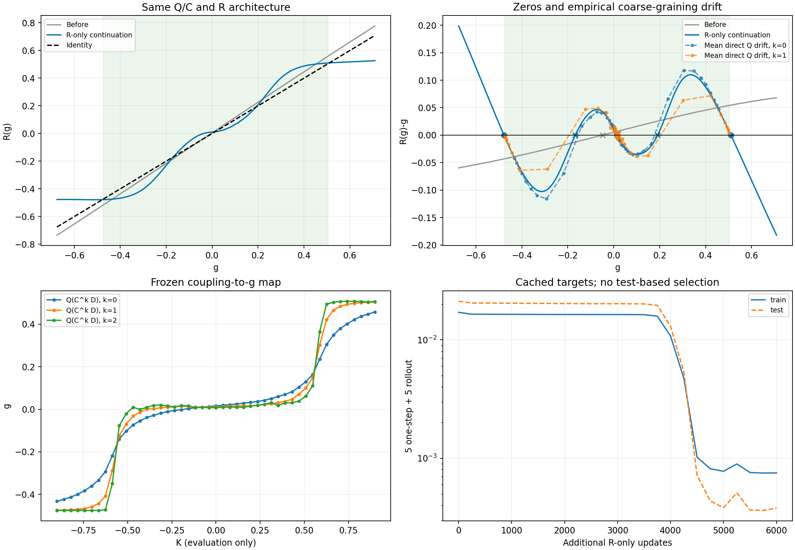

# Recurrent RG Network：从构型系综学习 QCR

更新：2026-11-05。默认输入为无耦合标签的构型系综，学习局域粗粒化 C、系综坐标 Q 和共享尺度映射 R：

$$
\mathcal D_k=C^k\mathcal D_0,\qquad g_k=Q(\mathcal D_k),\qquad R(g)=g+F(g).
$$

当前默认训练使用**随机初始化的可训练概率 C、经验 RSMI、逐系综方差下限及保色；Q 使用共享仿射分布重构，Q/C/R 同步更新但独立传递梯度**。不穷举选择核，不预训练 C，不使用耦合或相标签监督。真实耦合用于采样和事后物理诊断；采样区间的选择仍包含实验设计知识。历史实验及用户授权的冻结/PCA诊断、耦合监督消融单独标明，不等同于当前默认配方。

**末尾拟合默认（2026-11-05）：**联合训练后固定最终 Q/C，单独继续训练同一个 R。
标准新训练默认 `training.terminal_r_fit=true`，每条 TRAIN 物理链固定8组构型子集/C随机抽样，
编码仍为两个半系综 Q 输出的均值；全缓存等权拟合原 all-start 闭环目标，保留 R Adam 和末端学习率。
默认最多追加10,000步，每500步检查 TRAIN：至少3000步后，过去2000步的最佳损失改善不足1%、
当前损失距最佳不超过5%，连续三次满足才称操作性平台。到上限不称收敛，TEST/标签/根不选终点。
联合 checkpoint 和指标留在根目录，R-only 在 `r_only/`；`pipeline.json` 指向最终 checkpoint，
默认 `load_run(运行目录)` 和正式报告使用末尾模型，显式指定旧 checkpoint 仍读联合模型。
报告区分 Q/C 联合更新数和 R 总更新数。重复 C 抽样不是新独立物理链；不新增物理采样或 MI 训练。
资源预算须覆盖整个两阶段流程，预算用尽会保留联合结果并标记末尾阶段未完成。
历史加载/续训缺字段仍保持原流程；精确复现或联合训练单独消融须显式设置 false，历史结果不改写。

**最新进展：**二维 Ising K–B 扫描的逐构型 CNN 配对实验已完成监督权重 0、1、10 三组各 1250 步，以及权重 10、仅放开仿射解码器列范数的第四组。放开增益后，微观图案重构 MSE 从 0.02596 降至 0.00328，K 的留出仿射读出 R² 从 0.925 升至 0.974，但有限搜索仍未找到排斥子；尺度适配改善不等于临界结构恢复。详见[监督强度对照](#二维-ising-kb-扫描监督强度对照)及[解码增益消融](#放开解码增益的配对实验)。较早的三值自旋双相变结果保留在[历史实验记录](#二维三值自旋-ising两个对称相变点)。

这是有限尺度统计与潜空间动力学的研究原型，不能自动视为精确、闭合的物理 RG。

- [当前模型与训练](#模型与训练)
- [Loss 组成和目的](#loss-组成和目的)
- [近期二维 Ising K–B 监督强度对照](#二维-ising-kb-扫描监督强度对照)
- [精选实验及复现](#精选实验)
- [开发指南](docs/development.md)、[完整实验索引](experiments/README.md)
- [旧版 README 与历史 TFIM / Ising 记录](README.history.md)

## 模型与训练

| 模块 | 输入 → 输出 | 结构及职责 |
|---|---|---|
| C | 局域自旋块 → 一个粗粒化自旋 | 默认不重叠一维 2 格 / 二维 3×3 块，步长分别为 2 / 3；局域 MLP 输出 Bernoulli 或 categorical 概率 |
| Q | 同一系综的多份构型 → dim_g 维坐标 | 周期局域特征网络，跨样本与位置平均，再接输出网络；无显式总磁化输入 |
| R | g → 下一尺度 g | 残差 MLP，所有尺度共享参数，不显式输入 k |

C 在构型路径上随机采样，使用直通梯度估计；MI 与均匀块保色项直接使用输出概率。没有硬编码 Z2 或颜色置换等变性。当前不学习作用量 A，也没有输入耦合量、尺度编号或显式总磁化。

Q 先对每个有序局域窗口提取特征，再对系综样本和格点平移取平均；当前局域特征数为 12。它不是单构型分类器，也不直接输出物理耦合。以二维、hidden=96 为例，Q 的局域 MLP 为 `9c→96→12→12`，池化后的输出头为 `12→96→dim_g`；C 为 `9c→96→96→输出概率`，R 的残差网络为 `dim_g→96→96→dim_g`，中间激活均为 Tanh。二值输入 c=1，多类别输入为 c=q 的 one-hot。

辅助重构头是 Q 坐标上的**共享仿射 decoder**，不是另一个作用量网络。二维目标是有序 2×2 图案频率，有 q⁴ 个 bins；一维为自旋对，有 q² 个 bins。因此 Q 的 3×3 感受野、C 的 3×3 粗粒化块、重构目标的 2×2 图案是三个不同概念。

这里的“步/epoch”指训练循环更新次数，不表示完整遍历缓存一次。隐藏宽度、batch、数据范围和总步数由各实验配置决定，不能把历史精选实验的 hidden=60、2400 步当成所有新实验的默认规模。

默认入口是 `python -m recurrent_rg train --config CONFIG --output OUTPUT`，也可使用 `python -m experiments.rsmi_separate_qcr`。两者默认均使用经验 histogram MI 和独立梯度：

- Q 只优化表示目标；其粗粒化输入不向 C 反传 Q loss。
- C 只优化 MI、防塌缩及保色目标。
- R 只优化全起点、同终点锚定闭环；各目标尺度等权、每个终点内的全部早期起点等权。Q/C 不接收闭环梯度，R 的全部递推保留梯度。

因此它既不是 Q→C→R 逐个训练，也不是所有 loss 对三个模块全反传。**固定默认：Q 用共享仿射分布重构；随机概率 C，histogram MI 权重 2，逐系综 variance floor 权重 2 / ratio 1，保色权重 1，Q/C/R 独立梯度；未经用户明确要求不得改变。**缓冲区宽度 1，MI 使用微观尺度的完整环境壳层。

2026-10-09 按用户要求将重构头 loss 设为默认：新模型及默认入口的新训练使用
`affine_reconstruction=true`，替代原几何距离项，保留20/5子集一致性、C/R目标和随机初始化。
Q编码器结构不变，新增共享仿射decoder，列范数每步归一化；方向随机初始化，偏置仅用初始随机 C 下的训练图案分布均值校准，不使用PCA初始化或K监督。
显式 `affine_reconstruction=false` 保留几何消融；旧配置的反序列化、旧权重和resume
不自动增加decoder，历史实验结论不追溯改写。但默认入口的**从头新训练**若读取省略该字段的旧配置/manifest，会采用新的重构默认；复现旧几何目标必须在另存的配置中显式写 `affine_reconstruction=false`，不能修改历史 manifest。详细过程见[Q折叠诊断](docs/q_unfolding.md)。

当前双 Ising 扫描 `K1=K2/2` 的设置为：K2∈[0,1.3] 均匀 48 点、每点 2 个副本、每系综 64 构型，64 个训练 / 32 个测试系综，36→12→4，hidden=96，Adam 学习率 0.001，batch=8×64，seed=91，目标 1200 更新。dim_g=2 的 Q/C/R 参数量为 7,082 / 13,252 / 9,794，总计 30,128（含 Q decoder，不含未训练的 A）。这是单参数初始扫描，不是完整 K1/K2 二维采样；配置见[dim_g=2](configs/dual_ising2d_K1halfK2_g2_affineQ_joint_1200_seed91.json)。

同设置的 dim_g=1 已从实际 114 步短测续训至累计 1200 步，只有一个排斥子，插值 K2≈0.91796，尚未恢复两个边界；dim_g=2 的最终结果待训练/报告管线完成，暂不列为成功案例。不能把旧目录名中的 `1200` 当作其实际完成步数。详细记录见[双 Ising 实验](docs/dual_ising_reconstruction.md)。

改变固定 C loss/梯度配方的消融必须显式加 `--allow-nondefault-recipe`；联合阶段冻结 C、PCA 初始化及历史独立续训仍属于显式诊断。上文末尾固定 Q/C 的 R-only 阶段已按用户要求成为新管线默认。旧通用训练器需 `--allow-legacy-training`（Python API 为 `allow_legacy_training=True`）。旧配置文件的反序列化默认保持兼容，实际生效的 C 目标和梯度路由由默认训练入口设置并写入 manifest；不应只凭旧 JSON 的 `gradient_mode` 判断新实验。历史结果不追溯改写。

**二维块大小默认更新（2026-10-06）：**新配置使用 `schema_version: 5`，省略 `model.block_factor` 时二维取 3、一维取 2；显式设置仍被尊重。无版本号以及版本 1–4 的旧配置若省略该字段，仍取 2，旧 checkpoint 同样保持兼容。二维数据必须支持每次除以 3，例如 `36×36 → 12×12 → 4×4`，不能直接复用原来 `16×16` 的两步链。底层历史几何/MI API 的默认参数未追溯修改；默认训练入口会显式传入模型的实际块大小。

历史正负 K、B=0 的二维 Ising 单种子实验采用原几何 Q 目标、3×3 C、`dim g=1`、3000 epoch，得到“吸引—排斥—吸引—排斥—吸引”的标量流结构；两个排斥子的微观插值为 K≈−0.42432、+0.43349，理论边界为 ±0.440687。两端吸引子位于微观编码支持范围外，应视为外推。结果支持框架可学习两次相变的定性结构，但本次 L 也从 16 增至 36，并非只改核尺寸的严格消融，也不是多种子稳健性验证。

实验配置：[signed-K block3](configs/ising2d_signedK_B0_g1_block3_locked_recipe_h96_seed91.json)（历史版本 4，已显式设置 block_factor=3）；[R(g) 与耦合映射](results/ising2d_signedK_B0_g1_block3_locked_recipe_h96_3000_seed91/full_report/R_and_two_transitions.png)；[loss 曲线](results/ising2d_signedK_B0_g1_block3_locked_recipe_h96_3000_seed91/report/loss_comparison.png)。C/R 目标、初始化和独立梯度路由保留当时固定配方；Q 目标与当前仿射重构默认不同。

3×3 的 n 态块有 `n^9` 种输入。经验 MI 训练入口的显式资源上限现为262,144种，
支持四态联合自旋的3×3块；稀疏条件计数和完整环境壳层定义不变，不退回2×2。
四态仍需评价大型概率表，时间/内存明显高于二态；有限样本MI上偏仍需警惕。

## Loss 组成和目的

令两个独立子集的编码为 \(g^a_{ik},g^b_{ik}\)，\(\bar g_{ik}=(g^a_{ik}+g^b_{ik})/2\)。坐标误差使用平方范数，即对潜维度**求和**，然后对系综与尺度平均。

当前三个独立优化目标为：

$$
\begin{aligned}
\mathcal L_Q&=20\mathcal L_{\rm split,0}+5\mathcal L_{\rm split,coarse}+10\mathcal L_{\rm rec},\\
\mathcal L_C&=-2\widehat I(H;E)+2\mathcal L_{\rm variance}+\lambda_{\rm color}\mathcal L_{\rm color},\\
\mathcal L_R&=\frac{10}{S}\sum_{t=1}^{S}\frac1t\sum_{s=0}^{t-1}
\mathbb E_i\|R^{t-s}(\operatorname{sg}\bar g_{is})-\operatorname{sg}\bar g_{it}\|^2.
\end{aligned}
$$

**权重口径：**配置中的 `anchor=2` 乘的是代码内部已放大 10 倍的微观一致性项，所以相对原始平方误差的有效系数为 **20**，不是 2。日志中分项不应再重复乘这个内部因子。三个 Ising 保色实验取 λ_color=1；下面的三态 Potts 成功实验取 0。

默认 λ_color=1。历史几何项不再与仿射重构叠加；配置/日志沿用 `separation` 字段时，默认模式指的是权重为 10 的重构目标，不是额外的成对排斥项。

| 项 | 目的 | 更新模块 |
|---|---|---|
| 子集一致性 | 同一系综的不同抽样给出稳定坐标，避免编码抽样噪声 | Q |
| 仿射分布重构（默认） | g保留局域图案分布信息，减轻正负K的U形折叠；并不保证RG充分性 | Q及辅助decoder |
| 经验 RSMI | 粗变量保留隔着 buffer 的环境信息 | C |
| 逐系综方差下限 | 防止 C 把仍有变化的输入压为偏置或常数输出 | C |
| 均匀块保色（默认权重 1） | 固定颜色约定，抑制全同块的翻转 / 循环重标号 | C |
| 全起点锚定闭环（默认） | 每个早期尺度递推到同一直接编码终点；终点之间等权 | R |
| 历史一步／微观起点 rollout | 保留旧实验与诊断日志；不是额外叠加到新目标的项 | R |

### 1. 同系综子集一致性

$$
\mathcal L_{\rm split,0}=\mathbb E_i\|g^a_{i0}-g^b_{i0}\|^2,\qquad
\mathcal L_{\rm split,coarse}=\mathbb E_{i,k\ge1}\|g^a_{ik}-g^b_{ik}\|^2.
$$

它提高 Q 的抽样稳定性，但单独使用允许所有系综塌缩到同一点，必须配合重构等非平庸表示目标。

### 2. 默认表示目标：共享仿射重构

对每个尺度的局域图案概率（1D为自旋对，2D为有向2×2图案）：

$$
\mathcal L_{\rm rec}=\mathbb E_{i,k}\|\bar p_{ik}-b-W\bar g_{ik}\|_2^2,
\qquad \|W_{:,j}\|_2=1.
$$

对概率bins求和、系综及尺度平均；目标停止梯度，W/b只接受Q目标梯度。
不使用softmax、作用量或耦合标签；单位列范数避免g缩小而decoder放大的尺度退化，
但不强迫潜空间满秩，也不保证不存在折叠或跨尺度非闭合。
相同W/b跨尺度共享；当前无tail、协方差白化、弱方向加权R或局部轨迹排斥。
日志仍保留`separation`/`data_geometry_level_*`历史字段名；默认模式的值是重构MSE，
并新增`reconstruction_mse_level_*`字段明确其含义。

#### 历史分布几何：`relative_local`（显式关闭重构时）

在每个尺度统计局域模式频率 p（一维自旋对 / 二维 plaquette）。两个子集给出：

$$
\bar p_i=(p_i^a+p_i^b)/2,\quad \eta_i=\tfrac14\|p_i^a-p_i^b\|^2,\quad
d_{ij}=\|\bar p_i-\bar p_j\|,\quad a_{ij}=2\sqrt{\eta_i+\eta_j}.
$$

要求潜距离 \(r_{ij}=\|\bar g_i-\bar g_j\|\) 尽量落入统计容许区间：

$$
\ell_{ij}=[4(d_{ij}-a_{ij})_+-r_{ij}]_+^2+
[r_{ij}-4(d_{ij}+a_{ij})]_+^2.
$$

`relative_local` 用 \(s_{ij}=(4d_{ij})^2+(4a_{ij})^2+0.05^2\) 归一化：乘 \(\min(100,s_{ij}^{-1})\)，再按可靠性 \((4d_{ij})^2/s_{ij}\) 加权。全局配对平均与每个系综 4 个可分辨近邻的局部平均各占一半，无有效局部近邻时回退全局项；各尺度等权。

统计目标停止梯度。这里的噪声容许区间不是严格置信区间，也不是完整分布距离。该项允许物理上一维的流形嵌入二维，不强迫协方差各向同性或满秩。当前配方没有额外协方差白化、弱方向加权 R loss 或局部轨迹排斥项。

### 3. RSMI：有限经验分布上的直接求和

$$
\hat p(h,e)=\sum_v\hat p(v,e)P_C(h\mid v),\qquad
\widehat I(H;E)=\sum_{h,e}\hat p(h,e)\log\frac{\hat p(h,e)}{\hat p(h)\hat p(e)}.
$$

当前 `--estimator histogram` 不训练 critic；在微观尺度逐系综计数，使用全部缓存样本及平移位置。一维 V 为 2 格、E 为两侧各一个自旋；新二维默认 V 为 3×3、E 为完整 24 自旋外壳（历史 2×2 实验为 20 自旋外壳）。V 与 E 之间留出宽度为 1 的 buffer，buffer 不进入 E。

梯度经过概率核 P_C；这不是枚举候选核后选最优核。优化使用自然对数，报告的 MI 通常换算为 bit。所谓“精确 MI”仅指经验表上的有限求和，**不代表真实分布 MI 无偏**；大环境字母表尤其容易产生有限样本上偏。旧日志中的零值 shuffled MI 占位不能当作实测零偏差基线。

### 4. C 的逐系综方差下限

令 m 为一个系综内跨构型、跨位置的平均二值自旋，sg 表示停止梯度：

$$
\mathcal L_{\rm variance}=\mathbb E_{i,k}
\left[|m_{\rm out}|-\sqrt{1-\rho(1-\operatorname{sg}(m_{\rm in})^2)}\right]_+^2.
$$

多类别用颜色频率向量 p 替代：

$$
\mathbb E_{i,k}\left[\|p_{\rm out}\|-
\sqrt{1-\rho(1-\|\operatorname{sg}(p_{\rm in})\|^2)}\right]_+^2.
$$

当前取 ρ=1，逐系综、逐尺度计算，权重 2。它惩罚方差缩减，但允许常数输入保持常数，不要求每个系综各颜色均匀。这是一项软统计假设，不是对任意物理系统都严格成立的 RG 恒等式。

### 5. 保色（默认开启）

$$
\mathcal L_{\rm color}=-\frac1q\sum_{a=1}^q\log P_C(a\mid a,a,\ldots,a).
$$

只约束均匀块，混合块仍可学习；二值情形就是全正 / 全负块的 Bernoulli NLL。它不等于硬对称性，也不保证全局不存在周期轨道。三态 Potts 的精选结果未使用此项，应与保色 Ising 对照区分。

### 6. R 的全起点、同终点锚定闭环

2026-10-25 按用户要求，将 `all_start_anchor` 设为新实验默认。令共有 S 次 RG、S+1 个尺度点，默认目标为上面的单一双重求和：每个终点 t 的总权重均为10/S，终点内的所有起点 s<t 等权。没有额外预测—预测一致性惩罚，没有加入旧 `L_future`；二维块大小仍默认 b=3，本次 b=2 的配对实验只是显式消融。

当 S=1 或2且旧两分支外权均为5时，新旧目标代数等价；S≥3时增加中间起点的长程路径，同时重新分配同一终点内的权重。它统一了有限尺度链上的多步一致性，不能据此保证临界指数正确、无限深度泛化或精度提升。2026-10-25 的单seed、32→16→8→4实验在新增16→4路径的留出误差降低约3.5%，但另四条路径误差略升，因此采用默认的理由是定义简洁，不是已证明整体更优。

新 `LossConfig()` 使用新默认；反序列化缺少 `closure_objective` 的历史 JSON/checkpoint 仍解释为旧目标，续训继承 checkpoint 中保存的实际模式，不重新猜默认值。标准 `--config` 入口**从头训练**时若未指定该字段，会采用新默认；精确复现旧目标须在另存的配置中写 `loss.closure_objective="one_step_and_rollout"`，不能改历史 manifest。历史 `--source` 与显式历史消融入口仍保留自己的配方。新实验应另存配置并显式写 `"all_start_anchor"`，让实际目标可审计；不再需要 b=2／深度3的实验标记。兼容字段 `commutator=5` 与 `rollout_weight=5` 合为总权重10；旧分支诊断仍保留，但不再单独加入新总目标。

这与 [Lusch 等（2018）](https://pmc.ncbi.nlm.nih.gov/articles/PMC6251871/) 的 Koopman 学习中多步预测一致性思路相容，但当前 R 仍是非线性状态映射，不是已学到有限维线性 Koopman 算子。可另外研究提升后的可观测量与谱分析，但它们不是本次默认更改的一部分。

历史模式 `one_step_and_rollout` 仍使用：

$$
\mathcal L_{\rm step}=\mathbb E_{i,0\le k<n}\|R(\operatorname{sg}\bar g_{ik})-\operatorname{sg}\bar g_{i,k+1}\|^2,
$$
$$
\mathcal L_{\rm rollout}=\mathbb E_{i,1\le k\le n}\|R^k(\operatorname{sg}\bar g_{i0})-\operatorname{sg}\bar g_{ik}\|^2.
$$

覆盖缓存链的所有可用尺度，不只前两步；但不约束链长之外的无限次递推。R loss 不再通过收缩 Q/C 表示来降低自身误差。日志总量含负 MI，可能为负，不能只按其大小判断相变学习是否正确。

训练使用两个半系综编码的均值 \(\bar g\)，常规报告使用完整系综的 \(Q(\mathcal D_k)\)；Q 输出头非线性，二者并非代数恒等。下述三值自旋 R-only 诊断改用缓存的完整系综坐标，是明确的目标抽样方式变更。

## 二维 Ising KB 扫描：监督强度对照

2026-11-04 完成的**用户明确授权消融**：比较无监督、弱监督和强监督；不将耦合标签监督加入默认配方，也不据此将本实验的 CNN 编码器设为通用入口默认结构。

三组复用相同数据和划分：K=0.20:0.03:0.68、B=−0.010:0.001:0.010，共 357 个参数格点，每点 2 条独立物理链、每链 64 个构型；按整个参数格点划分为 TRAIN 474 条链、TEST 240 条链。格点尺度为 36→12→4，b=3，dim_g=2，seed=91。Q 为跨尺度共享的逐构型 CNN，C 为随机初始化的可训练概率核，R 为残差 MLP；三组从相同随机权重、fresh Adam 开始，各完成 **1250 次 Q/C/R 更新**，学习率分别为 0.001/0.001/0.003，batch=32 个系综。数据、初始化、C/R 目标、梯度路由和训练长度保持一致，改变项只有监督权重。

监督项为

$$
\mathcal L_Q^{(\lambda)}=\mathcal L_Q+
\lambda\,\mathbb E_i\|Q(\mathcal D_{i,0})-z_{\rm TRAIN}(K_i,B_i)\|^2,
\qquad \lambda\in\{0,1,10\}。
$$

标准化只使用 TRAIN 参数。标签仅监督完整微观系综的 Q，不监督粗尺度，不更新 C/R；R 仍使用两个半系综编码均值作为目标，以均匀 `all_start_anchor` 训练。Q 原有共享仿射重构和有效权重 20/5 的子集一致性保留，decoder 列范数仍逐步归一化。完整系综编码与半系综编码均值分别保存，不能将两种估计器混为一谈。

**正式留出集结果。**图案重构误差是相同 16 个有序 2×2 图案概率的逐分量 MSE，先对图案分量及系综平均。训练中的重构项对 16 个分量求和：在相同样本与尺度上，其未加权数值是逐分量 MSE 的 16 倍，再按目标平均尺度、乘权重；随机训练 batch 日志不能与全留出集指标逐值对应。参数读出是在 TRAIN 上事后拟合的仿射映射、在 TEST 上计算 R²，不是直接监督坐标误差，也没有用于选择模型。

| 留出集指标 | 无监督 λ=0 | 弱监督 λ=1 | 强监督 λ=10 |
|---|---:|---:|---:|
| k=0，L=36 图案重构 MSE | 0.0000416 | 0.000793 | 0.02596 |
| k=1，L=12 图案重构 MSE | 0.0000497 | 0.000361 | 0.00453 |
| k=2，L=4 图案重构 MSE | 0.000117 | 0.000241 | 0.00283 |
| 微观 K 仿射读出 R² | 0.944 | 0.905 | 0.925 |
| 微观 B 仿射读出 R² | 0.494 | 0.536 | 0.838 |

强监督的三尺度图案重构误差分别约为无监督的 624、91、24 倍；训练集也同样偏高，不能解释成普通的“训练集好、测试集差”。但 B 的参数可读性确实改善，不能说 Q 的所有功能都变差。三组已保存的 C 目标图案统计逐元素一致，最终 TEST MI 均为 0.341324，没有 C 退化的证据。

R 的 TEST 闭环 NRMSE（36→12、12→4、36→4）在无监督下为 4.71%、6.23%、9.40%，强监督下为 9.69%、10.25%、11.09%；弱监督为 6.51%、6.53%、7.58%。这些 NRMSE 分别使用各模型自己的 TRAIN 目标标准差，坐标系也发生变化，不能把差值直接解释为同一个物理误差或单独归因于 R 优化器。

**事后诊断，不是新增训练结果。**仅读已保存的 `evaluation_arrays.npz`，固定 Q 编码与 C 输出，在 TRAIN 的全部尺度上最小二乘拟合一个不限制列范数的共享仿射 decoder，并在 TEST 验证：强监督微观图案 MSE 从 0.02596 降至 0.00477，下降约 82%。该诊断同时放松列范数并重新求解 decoder，不足以单独分离两者贡献；剩余误差仍明显高于无监督，也不能据此保证更换 decoder 会改善不动点。

使用保存的重构输出还可精确恢复原仿射 decoder（全数组最大复现误差约 5.2×10⁻¹⁵），再解码已保存的 R 预测。强监督的 36→12 图案预测 MSE 为 0.00454，而直接解码真实目标 g₁ 的重构 MSE 已为 0.00453，说明这项端到端统计误差在目标表示/解码阶段已经很大。两种误差含交叉项，不能相减当成独立的 R 误差贡献。

这些证据支持一个具体问题：`g₀≈标准化(K,B)` 固定了参数坐标尺度，而 `pₖ≈Wgₖ+b、‖W[:,j]‖=1` 同时固定了解码器的增益，并要求跨尺度共享；当前训练在两种要求之间出现明显折衷。它不证明标签天然不利于 RG，也不证明 Q 必然丢失了全部相关信息。上述事后分析没有更新 Q/C/R；随后实际训练的消融见下文，通用默认架构及 loss 不因此改变。

有限范围查根中，无监督找到一个训练编码凸包内的排斥子及一个外推鞍点；弱监督找到凸包内的排斥子和鞍点；强监督仅找到外推鞍点。凸包内不等于根附近有充分数据支撑，未找到也不证明不存在；这些数值根均未认证为物理临界点，`thermal_nu=null`。本轮只有一个训练 seed、36→12→4 的有限尺度和每格点两条物理链，历史数据也未新增热化认证。

[三组正式数值对照](results/ising2d_KB_cnn_supervision1_matched1250_seed91_vm225_20261104_monitor/final/report/comparison.json) · [强监督 manifest](results/ising2d_KB_cnn_supervised_short_seed91_vm225_20261104_monitor/final/manifest.json) · [事后诊断使用的强监督公共数组](results/ising2d_KB_cnn_supervised_short_seed91_vm225_20261104_monitor/final/evaluation_arrays.npz) · [监督项与梯度路由实现](experiments/ising_kb_supervised_short.py) · [仿射重构与列范数约束](recurrent_rg/representation.py)

| 监督权重 | 微观流场：灰色箭头 R(g)−g、参数着色散点 | 参数到 g 的映射 | Loss 曲线 |
|---|---|---|---|
| 0 | [流场](results/ising2d_KB_cnn_unsupervised_matched1250_seed91_vm225_20261104_monitor/final/report/R_flow_by_KB_k0.png) | [K/B–g](results/ising2d_KB_cnn_unsupervised_matched1250_seed91_vm225_20261104_monitor/final/report/Q_g_KB.png) | [曲线](results/ising2d_KB_cnn_unsupervised_matched1250_seed91_vm225_20261104_monitor/final/report/loss_curves.png) |
| 1 | [流场](results/ising2d_KB_cnn_supervision1_matched1250_seed91_vm225_20261104_monitor/final/report/R_flow_by_KB_k0.png) | [K/B–g](results/ising2d_KB_cnn_supervision1_matched1250_seed91_vm225_20261104_monitor/final/report/Q_g_KB.png) | [曲线](results/ising2d_KB_cnn_supervision1_matched1250_seed91_vm225_20261104_monitor/final/report/loss_curves.png) |
| 10 | [流场](results/ising2d_KB_cnn_supervised_short_seed91_vm225_20261104_monitor/display_KB_v1/R_flow_by_KB_k0.png) | [K/B–g](results/ising2d_KB_cnn_supervised_short_seed91_vm225_20261104_monitor/final/report/Q_g_KB.png) | [曲线](results/ising2d_KB_cnn_supervised_short_seed91_vm225_20261104_monitor/final/report/loss_curves.png) |

### 放开解码增益的配对实验

2026-11-04 按用户授权完成独立的第四组：仍为强监督 λ=10、同一 seed/初始化/数据/学习率及 1250 次 Q/C/R 更新，仅取消每次 Adam 后将仿射 decoder 列范数投影到 1 的操作。初始权重（包括初始单位列范数）及 TRAIN 均值偏置校准保持相同；无额外网络、非线性 decoder 或粗尺度标签。专用配置显式记录 `decoder_column_constraint="free_after_initialization"`，不改变其他训练入口的单位列范数默认。

**监督位置仍只有物理尺度 k=0 的完整系综编码。**这不是只训练 Q 网络的第一层：监督通过整个共享 Q 编码网络反传，因而间接改变 k≥1 的输出；decoder 由重构项学习，C/R 不接收监督梯度。

正式管线约 9 分 50 秒完成，所有 Q/C/R Adam 参数各更新 1250 次，父子进程正常退出。最终 decoder 两列范数为 0.237225、0.562457，三组历史对照的 C 目标统计均与新组逐元素一致。下表均为同一留出集结果：

| 指标 | 原强监督：单位列范数 | 新强监督：自由列范数 |
|---|---:|---:|
| k=0 图案重构 MSE | 0.025963 | 0.003280 |
| k=1 图案重构 MSE | 0.004529 | 0.001931 |
| k=2 图案重构 MSE | 0.002828 | 0.001003 |
| 微观 K 仿射读出 R² | 0.9248 | 0.9743 |
| 微观 B 仿射读出 R² | 0.8384 | 0.8270 |
| 36→12 经各自 decoder 解码后的图案预测 MSE | 0.004540 | 0.001655 |

微观重构误差下降约 87%，36→12 的图案预测误差下降约 64%，支持尺度约束确实造成了相当一部分统计重构困难。但微观重构仍差于无监督组的 0.0000416，B 读出也没有改善。各自 TRAIN 标准差归一化的闭环 NRMSE（36→12、12→4、36→4）由 9.69%、10.25%、11.09% 变为 10.15%、11.33%、13.08%；坐标及归一化分母不同，不能只据此认定同一物理预测变差。

新组有限范围搜索找到两个数值根：吸引点 g≈(−0.83202,0.01225)，乘子 (−0.07471,0.32611)；鞍点 g≈(−0.33805,−0.74382)，乘子 (1.76235,0.66378)。均位于训练编码凸包内，但鞍点距最近训练编码约 0.129，局部数据支撑有限；没有找到排斥子，也未将这些根认定为物理临界点。**本次解决了人为固定解码增益的尺度冲突，并改善了重构，但没有解决完整的临界流场学习问题。**单 seed、有限尺寸及采样限制仍保留，`thermal_nu=null`。

本轮新增及相关回归检查共 19 项通过；625 个历史数值实现文件指纹保持一致。只下载了白名单公共结果和启动/执行回执，共 23 个文件逐 SHA 校验，不包含 checkpoint、物理构型或 MI 缓存。

[实验配置](configs/ising2d_KB_cnn_supervision10_free_decoder_matched1250_seed91.json) · [专用训练入口](experiments/ising_kb_free_decoder_matched.py) · [四组对照](results/ising2d_KB_cnn_supervision10_free_decoder_matched1250_seed91_vm225_20261104_monitor/final/report/comparison.json) · [完整 manifest](results/ising2d_KB_cnn_supervision10_free_decoder_matched1250_seed91_vm225_20261104_monitor/final/manifest.json)

[微观 R(g) 流场](results/ising2d_KB_cnn_supervision10_free_decoder_matched1250_seed91_vm225_20261104_monitor/final/report/R_flow_by_KB_k0.png) · [各尺度 K/B–g 映射](results/ising2d_KB_cnn_supervision10_free_decoder_matched1250_seed91_vm225_20261104_monitor/final/report/Q_g_KB.png) · [loss 曲线](results/ising2d_KB_cnn_supervision10_free_decoder_matched1250_seed91_vm225_20261104_monitor/final/report/loss_curves.png) · [解码增益变化](results/ising2d_KB_cnn_supervision10_free_decoder_matched1250_seed91_vm225_20261104_monitor/final/report/decoder_gains.png)

## 精选实验

前四项为历史原几何 Q 目标、hidden=60、seed=91、Adam 学习率 0.001、batch=32×64、预定最终 2400 步的单种子结果，不按临界位置挑选早停检查点。它们不是新增仿射重构默认目标的严格复现。新增三值自旋结果使用 hidden=96、分阶段诊断，具体冻结与初始化方式见下文。保留效果较好的定性结构，同时明确支持范围及误差；尚不能据此宣称多 seed 鲁棒性、完整相图或临界指数都已恢复。

| 问题 | dim_g | 参数量 | 已恢复的主要结构 | 主要限制 |
|---|---:|---:|---|---|
| 1D 经典 Ising | 1 | 9,711 | 有序端不稳定、无序端稳定，流向正确 | 深尺度闭环误差大 |
| 1D 经典 Ising | 2 | 9,893 | 近一维流形，有序端鞍点、无序端吸引子 | 有序端外推，位置精度退化 |
| 2D 经典 Ising，K/B | 2 | 10,373 | 中心两方向均不稳定的排斥子 | 临界 K 插值偏低约 3.20% |
| 2D 三态 Potts，零场 | 1 | 11,873 | 中间不稳定、两侧稳定的标量结构 | 一个吸引子在训练支持外；未保色 |
| 2D 三值自旋 Ising，正负 K | 1 | 27,407 | 消除微观 U 形；两个独立排斥子及中间吸引子 | 冻结 C/PCA 诊断后 R-only 续训；临界插值偏低约 4.9% / 4.7%，两端吸引子外推 |

下列前四项保留**当时的历史命令**，依赖已有 source 配置与数据缓存；普通从头训练模式的 `--source` **仅读配置，不恢复旧模型权重**（后文 R-only 入口不同）。旧 manifest 缺少 `affine_reconstruction` 字段，不能直接把这些命令在当前默认入口的结果称为历史复现：应另存其配置、显式补 `model.affine_reconstruction=false`，以 `--config` 替代 `--source`，并核验架构、数据指纹及实际更新数。输出使用新的 `_repro` 目录，历史配置和权重不得覆盖。完整数据生成和报告命令见各实验记录；本地缓存、检查点和图片不保证随 Git 分发。

---

### 1D 经典 Ising：dim_g=1

零场周期链 L=128→64→32→16→8→4，64 个无量纲 J=J_phys/T∈[0.01,2]，每点 3 个系综、每系综 128 构型；129 个训练系综 / 63 个留出系综。注意：**不是 TFIM，也没有有限温度临界点**。

C 学到近似正 decimation。R 的有序端不稳定根 g≈0.01475，乘子 1.54102；无序端稳定根 g≈1.95142，乘子 0.08485。300 个诊断 J 的流向均正确，相对精确 decimation 参考的一步 RMSE / 端点跨度约 1.07%。测试首步 NRMSE=3.78%，第 5 步 rollout NRMSE=58.10%，不能称为所有尺度精确闭环。

```bash
python -m experiments.rsmi_separate_qcr \
  --source results/ising1d_g1_random_independentC_variance2ratio1_2400_seed91/qr \
  --output results/ising1d_g1_color1_repro/qr \
  --estimator histogram --variance-weight 2 --variance-ratio 1 \
  --variance-per-ensemble --independent-c --color-weight 1
```


[详细记录](docs/ising_color_comparison.md) · [各尺度 J–g](results/ising1d_g1_random_independentC_variance2ratio1_color1_2400_seed91/qr/full_report/coupling_by_scale.png) · [loss 曲线](results/ising1d_g1_random_independentC_variance2ratio1_color1_2400_seed91/qr/report/loss_comparison.png)

---

### 1D 经典 Ising：dim_g=2

使用同一份数据。Q 表示近似一维，population 编码弱主成分占比约 2.64×10⁻⁶。鞍点 g≈(0.08504,−0.20728)，DR 特征值约 (1.22713,0.33305)；吸引子 g≈(1.80140,−1.46916)，特征值约 (0.32129,−0.05039)。鞍点的不稳定方向沿物理流形，横向稳定。

300 个 J 的位移方向均符合精确参考。但有序端在训练支持外，归一化端点位置误差约 11.84%；测试首步 / 第 5 步 rollout NRMSE 为 7.65% / 80.15%。无保色版本有序端误差较小（5.40%），见[原始对照](docs/ising1d_g2_random_gradient_mi.md)。

```bash
python -m experiments.rsmi_separate_qcr \
  --source results/ising1d_g2_random_independentC_variance2ratio1_2400_seed91/qr \
  --output results/ising1d_g2_color1_repro/qr \
  --estimator histogram --variance-weight 2 --variance-ratio 1 \
  --variance-per-ensemble --independent-c --color-weight 1
```


[详细记录](docs/ising_color_comparison.md)

---

### 2D 经典 Ising：dim_g=2，K/B 双参数

\(P(X)\propto\exp(K\sum_{\langle ij\rangle}s_is_j+B\sum_i s_i)\)，K=J/T、B=h/T，非二维 TFIM。格点 16×16→8×8→4×4；K=0.20:0.03:0.68，B=−0.01:0.001:0.01，每个系综 64 构型。

C 学得近似对块内三个自旋做正多数票，非预设此规则。中心排斥子 g≈(−0.17197,0.05356)，DR 特征值 (1.56649,1.12415)，两者均大于 1，**不是鞍点**。微观网格内反插值 K≈0.426565、B≈−0.000493；相比理论零场 Kc≈0.440687，K 偏低约 3.20%。

测试两尺度一步 NRMSE=3.74%、5.21%，两步 rollout=6.62%。另外两个鞍点没有微观网格内反插值，不直接赋予确定的 K/B。有限范围 R² 查根未发现额外二周期，不构成全局证明。

```bash
python -m experiments.rsmi_separate_qcr \
  --source results/ising2d_g2_random_independentC_variance2ratio1_2400_seed91/qr \
  --output results/ising2d_g2_color1_repro/qr \
  --estimator histogram --variance-weight 2 --variance-ratio 1 \
  --variance-per-ensemble --independent-c --color-weight 1
```


[详细记录](docs/ising_color_comparison.md) · [无保色随机核对照](docs/ising_random_gradient_mi.md)

**固定默认后的复现（2026-10-05）**：以下命令只读取历史配置，不加载历史权重，也没有显式传入 loss 开关：

```bash
python -m experiments.rsmi_separate_qcr \
  --source results/ising2d_g2_random_independentC_variance2ratio1_color1_2400_seed91/qr \
  --output results/ising2d_g2_locked_recipe_repro_2400_seed91/qr
```

2400 步训练循环耗时 234 秒。数据指纹、完整生效配置、25 次日志的全部指标和最终 Q/C/R 每个权重张量均与历史实验完全一致（最大权重差 0）。中心排斥子 g=(-0.171966, 0.053559)，DR 乘子=(1.566488, 1.124152)，微观网格反插值 (K,B)=(0.426565,-0.000493)。这是同 seed 的严格复现，不是跨 seed 鲁棒性验证。

[复现审计](results/ising2d_g2_locked_recipe_repro_2400_seed91/qr/report/reproduction_audit.json) · [本次流场](results/ising2d_g2_locked_recipe_repro_2400_seed91/qr/report/R_flow_and_center.png) · [K/B 映射](results/ising2d_g2_locked_recipe_repro_2400_seed91/qr/report/g_KB_maps.png) · [loss 曲线](results/ising2d_g2_locked_recipe_repro_2400_seed91/qr/report/loss_comparison.png)

---

### 2D 三态 Potts：dim_g=1

零场 \(P(X)\propto\exp(K\sum_{\langle ij\rangle}\delta_{s_i,s_j})\)。L=16→8→4，64 个 K∈[0.4,1.6]，每点 3 个系综、每系综 128 构型；129 个训练 / 63 个留出系综。

最终不稳定点 g≈1.583052，R′≈1.393651，唯一微观反插值 K≈0.993806；理论 Kc=log(1+√3)≈1.005053，偏低约 **1.12%**。两侧稳定根 g≈0.782294 和 3.149505，其中后者位于 R 训练输入范围之外，不能声称完整验证了两个物理吸引子。

一步 NRMSE=4.37%、5.18%，两步 rollout=7.91%。此实验**保色权重为 0**；均匀块学到 0→1→2→0 的颜色循环，Q 在已测试微观构型上对全局重标号近似不变，不等于严格对称或任意尺度无周期。当前结果使用最终 2400 步，不是选取早期较好的检查点。

```bash
python -m experiments.rsmi_separate_qcr \
  --source results/potts2d_g1_MIinit_independentC_variance2_2400_seed91_fast \
  --output results/potts2d_g1_random_ratio1_repro \
  --estimator histogram --variance-weight 2 --variance-ratio 1 \
  --variance-per-ensemble --independent-c --color-weight 0 --allow-nondefault-recipe
```

source 名称含 MIinit，但本命令没有 `--mi-initialize` 或恢复权重，仍从随机概率 C 开始。


[详细记录与限制](docs/potts_random_gradient_mi.md) · [loss 曲线](results/potts2d_g1_random_independentC_variance2ratio1_2400_seed91/report/loss_comparison.png)

---

### 补充：八态 Potts

八态零场 Potts 的单种子 dim_g=1、保色权重 1 实验也已完成。理论一级相变 Kc=log(1+√8)≈1.342454；不稳定点反插值 K≈1.327668，偏低约 1.10%。这只支持转变位置识别，尚不能从该局部流场断言已区分一级与连续相变或验证标度律。

```bash
python -m experiments.rsmi_separate_qcr \
  --config configs/potts2d_q8_g1_random_color1_seed91.json \
  --output results/potts2d_q8_color1_repro \
  --estimator histogram --variance-weight 2 --variance-ratio 1 \
  --variance-per-ensemble --independent-c --color-weight 1
```

[数据、命令与有限样本限制](docs/potts8.md) · [相图与 K–g](results/potts2d_q8_g1_random_mi_variance2ratio1_color1_2400_seed91/full_report/R_and_K_mapping.png)

---

### 二维三值自旋 Ising：两个对称相变点

这里是 spin-1 模型 \(s_i\in\{-1,0,+1\}\)，不是三态 Potts，也不是两套不耦合 Ising：

$$
P(X)\propto\exp\left(K\sum_{\langle ij\rangle}s_is_j\right),\qquad \Delta=B=0.
$$

负 K、弱耦合、正 K 分别对应反铁磁、无序、铁磁区域。数据 K∈[−0.9,0.9] 均匀取 47 点，31 个训练 / 16 个测试耦合点、每点 2 个系综，每系综 64 构型，共 62 个训练 / 32 个测试系综；按整个 |K| 单元留出，正负两侧及同 K 副本不跨训练/测试，不能把同 K 副本当作独立测试耦合。格点 36→12→4，dim_g=1、hidden=96，Q/C/R 参数量为 5,515 / 12,291 / 9,601，合计 27,407；Q 中仿射 decoder 为 162 参数。

**解决的问题与实际流程：**原距离几何目标下 g(K) 容易 U 形折叠；有序局域图案在 Q/C 输入中仍可辨识。改为共享仿射分布重构后，冻结 C 的 QR 诊断展开了微观 g(K)，但短训练的 R 仍只找到一个排斥子。随后冻结 Q/C，继续训练原 R，最终拟合出两条分界；没有使用 K 或相标签。

1. 从随机可训练概率 C 和随机 Q/R 开始，默认独立梯度同步训练；时限内实际完成 **359 步**，不是目录名中的 360 步。
2. 用户授权冻结第 359 步的**已学习 C**（不是固定 decimation），继承 Q/R 权重；仅用 TRAIN 图案分布 PCA 初始化仿射 decoder，重置 Adam，QR 独立梯度更新，实际完成 **433 次新更新**。微观测试 Spearman 绝对值约 0.9985，微观回折变化占比为 0；最粗尺度仍有约 1.2% 小幅回折，不能称为严格单射。
3. 用户授权冻结 Q/C 及 decoder，继承原 R 与 Adam 动量；用 62 个 TRAIN **完整系综**的缓存轨迹全批次拟合 R，追加 **6000 步**，Adam step 从 433 到 6433。保持原 9,601 参数残差 Tanh MLP、学习率 0.001 和一步/多步权重 5/5。此阶段约 44.2 秒，Q/C 最大参数差均为 0；TEST 只用于评估，没有测试选检查点。

最终搜索区间 g∈[−0.6754,0.7089] 内得到五个根：

| g* | R′(g*) | 稳定性 | 微观 K 插值 | 在观测 TRAIN R 输入范围内 |
|---:|---:|---|---:|---|
| −0.477979 | 0.040087 | 吸引 | 无 | 否 |
| −0.167730 | 1.890856 | 排斥 | −0.561587 | 是 |
| +0.013348 | 0.200437 | 吸引 | −0.034757 | 是 |
| +0.190939 | 1.848119 | 排斥 | +0.562658 | 是 |
| +0.510441 | 0.102112 | 吸引 | 无 | 否 |

两个排斥子是**两个独立不动点**，各有一个微观插值分支，不是同一根对应正负两个 K。相对此前采用的数值临界参考 ±0.59067，插值分别偏向零约 **4.9% / 4.7%**；该参考不是解析精确值。两端吸引子没有微观反插值，且在 TRAIN R 输入范围外，属于外推，不能据此宣称完整验证了三个物理吸引子。

| 测试闭环指标 | R 续训前 | 追加 6000 步后 |
|---|---:|---:|
| 一步 0→1 NRMSE | 14.948% | 2.242% |
| 一步 1→2 NRMSE | 10.347% | 1.977% |
| 两步 rollout NRMSE | 21.386% | 2.058% |

分母固定为原 TRAIN 目标的逐尺度标准差，没有重新缩放 g。最终固定目标的 TRAIN / TEST 加权闭环 loss 为 0.0007507 / 0.0003788。三个新 C 抽样种子下，两步测试误差为 1.98%–2.16%；这是同一训练种子和同一批微观测试构型的抽样审计，**不是多训练 seed 验证**。

这组结果支持“仿射重构展开 Q 后，原 R 结构有能力拟合两个相变边界”。但成功流程包含冻结、TRAIN-only PCA 和固定完整系综目标，因此不是默认从头联合训练的严格复现，也不能将改善单独归因于增加 epoch。

以下命令是上述**明确授权的诊断流程**，不是以后新实验自动采用的默认配方；输出改用 `_repro` 以免覆盖历史产物：

```bash
# 1. 随机 QCR；首次学习 C，不冻结、不预训练、不做 PCA
python -m experiments.rsmi_separate_qcr \
  --config configs/spin1_signedK_g1_affineQ_joint_360_seed91.json \
  --output results/spin1_affineQ_joint_repro --max-wall-seconds 540

# 2. 冻结已学习 C；显式 TRAIN-only PCA 初始化重构轴
python -m experiments.rsmi_separate_qcr \
  --config configs/spin1_signedK_g1_affineQ_frozenC_pca_QR_1200_seed91.json \
  --freeze-c-checkpoint results/spin1_affineQ_joint_repro/checkpoint_last.pt \
  --affine-pca-init --output results/spin1_affineQ_frozenC_QR_repro \
  --max-wall-seconds 540

# 保存完整系综 Q 轨迹，供下一阶段 R-only 固定目标拟合使用
python -m scripts.report_scalar_joint --run results/spin1_affineQ_frozenC_QR_repro

# 3. 保留 Q/C、R 结构与 Adam；此处 epochs 是追加 R 更新数
python -m experiments.rsmi_separate_qcr \
  --source results/spin1_affineQ_frozenC_QR_repro \
  --output results/spin1_affineQ_R_continue_repro \
  --r-only-continue --epochs 6000 --max-wall-seconds 540
```

前两阶段按墙钟时限退出，复跑的实际步数可能不同；命令演示流程，严格复现必须核对实际 source 检查点和数据指纹。原数据 SHA256 为 `f68f19b454d06588f0e9317ae7e5e54aa510ce4030da89d17b53632a36393979`。



[数值报告与抽样审计](results/spin1_signedK_g1_affineQ_frozenQC_R_continue6000_seed91/report.json) · [实验 manifest](results/spin1_signedK_g1_affineQ_frozenQC_R_continue6000_seed91/manifest.json) · [不动点原始数据](results/spin1_signedK_g1_affineQ_frozenQC_R_continue6000_seed91/after/fixed_points.json) · [Q 折叠诊断及完整过程](docs/q_unfolding.md)

## 如何解读图像与验收结果

- 流场箭头画 R(g)−g；标量图画 R(g) 并与 y=g 比较。稳定性判断使用 **DR** 特征值的模，不靠箭头的视觉印象；R² 图使用 R²(g)−g。
- 微观耦合–g 反插值仅在采样支持内且映射可辨识时成立，不能给任意粗尺度 g 都赋予唯一微观耦合。
- 区分定性不动点结构、临界位置误差、逐尺度闭环误差；三者不能互相替代。临界指数还要求正确的尺度因子、临界固定点及相关方向，以上结果并非临界指数验收。
- 当前未把 Ashkin–Teller 的三相实验列为成功案例。固定 decimation 也不保证粗粒化后出现三个孤立吸引子。

## 开发与历史记录

公共模型、loss、配置、数据和评估位于 `recurrent_rg/`；数据生成和报告入口在 `scripts/`，专项研究驱动在 `experiments/`。当前 `python -m recurrent_rg train` 默认委托上述 MI/独立梯度驱动，两者使用同一固定训练配方；显式解锁的旧通用训练器不是同一个目标。复现历史实验仍需保留其实际入口、架构与配置，不能只按目录名或当前默认值推断。

参见 [开发指南](docs/development.md)、[实验索引](experiments/README.md) 及 [历史 README](README.history.md)。历史无保色实验现在需要显式消融开关，不能视为当前默认配置。
