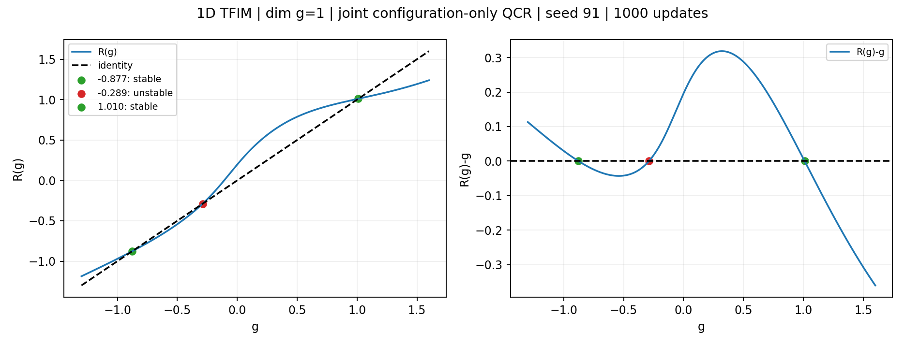
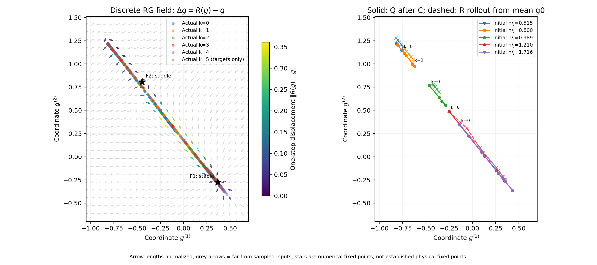

# 历史 README（归档于 2026-10-03）

以下“当前”“默认”均属于历史语境。最新模型、loss 与精选结果以 [README.md](README.md) 为准；这里保留旧实验及复现记录。

# Recurrent RG Network：无耦合标签的 QCR

从构型系综联合学习局域粗粒化 \(C\)、低维理论坐标 \(Q\) 和共享的 RG 映射 \(R\)：

$$
\mathcal D_k=C^k(\mathcal D_0),\qquad
g_k=Q(\mathcal D_k),\qquad
R(g)=g+F(g).
$$

支持 **Q/C/R 联合训练**和 **先 QC、再冻结 QC 训练 R**；最近二维 Ising 对照采用后者。
不使用 RSMI、作用量 A、耦合标签、相标签或已知临界点训练。
模型只知道哪些构型属于同一系综；真实耦合仅用于数据生成和事后绘图。
这是学习有限尺度统计及其潜空间动力学的研究原型，不预设潜坐标就是完整物理耦合。

本页实验记录更新至 **2026-09-27**。各实验用分割线隔开，列出命令和已保存相图。
一维 TFIM 为历史基线；二维经典 Ising 的 K/B 实验不是二维 TFIM。

---

## 关键实验：一维 TFIM，dim g=1 与 dim g=2

同一物理问题、同一份缓存数据：周期一维横场 Ising
\(H=-J\sum_i Z_iZ_{i+1}-h\sum_i X_i\)，无纵向场。
Q/C 只读取等时自旋构型，参数 \(h/J\) 不进入 loss。

| 设置 | dim g=1 | dim g=2 |
|---|---|---|
| 原始链长与尺度 | 128→64→32→16→8→4 | 相同 |
| 隐藏层宽度 / seed | 60 / 91 | 60 / 91 |
| 优化的 Q/C/R 参数量 | 9,711 | 9,893 |
| 展示检查点 | 联合训练第 1,000 步 | 联合训练第 6,000 步 |
| R-only 后处理拟合 | 无 | 无 |

数据包含64个均匀的 \(h/J\in[0.01,2]\) 取值，每个3条采样链、每系综128构型。
按耦合划分129个训练系综、63个测试系综（同一耦合的所有 replica 在同一侧），
共24,576个原始构型。训练每步抽32个系综，每系综128个样本并作全局翻转增强。
Suzuki–Trotter 数据取 \(M=32,\Delta\tau=0.5,\beta=16\)；有限温度和离散误差仍需独立控制。

**这是两个已完成联合训练检查点的定性展示，不是等训练预算、多 seed 的维度优劣比较。**
标量采用此前两侧保持分离的第1,000步：它的第2,000步曾出现临界两侧长期汇合。
向量采用原 coordinate-sum 模型续训至6,000步；并未替换成固定 Q/C 的 R-only 对照。

### dim g=1：R(g) 与恒等线

新训练命令（展示的是已有第 1000 步权重，不会覆盖它）：

~~~bash
python experiments/joint_qcr_tfim_1d.py \
  --sites 128 --levels 6 --hidden 60 --theory-dim 1 \
  --ensemble-size 128 --sample-batch 128 --system-batch 32 \
  --epochs 1000 --seed 91 --binary-lookup \
  --objective-mode data_geometry --coordinate-reduction sum --rollout-weight 5 \
  --output-dir results/tfim_g1_new_run
~~~

数值不动点为 \(g=-0.87699,-0.28898,1.01028\)，对应导数
\(0.78063,1.39458,0.32543\)：两侧稳定、中间不稳定。

---

### dim g=2：二维潜空间流

初始 2000 步的训练命令：

~~~bash
python experiments/joint_qcr_tfim_1d.py \
  --sites 128 --levels 6 --hidden 60 --theory-dim 2 \
  --ensemble-size 128 --sample-batch 128 --system-batch 32 \
  --epochs 2000 --seed 91 --binary-lookup \
  --objective-mode data_geometry --coordinate-reduction sum --rollout-weight 5 \
  --output-dir results/tfim_g2_new_run
~~~

下图不是这个新目录的结果，而是历史原始 checkpoint 连续续训至 6000 步的结果。
历史续训命令为 `python -m scripts.continue_tfim_g2`；**该脚本源/输出路径写死且会写入已有目录，
复现前必须调整路径，不能直接在已有结果上重跑**。它恢复原 Adam 和 RNG 状态。

箭头为离散位移 **\(R(g)-g\)**，不是位置向量 \(R(g)\)；箭头长度归一化，颜色表示原始位移。
灰色箭头位于离观测输入较远的区域。绘图区内有一个稳定点
\((0.36714,-0.27303)\) 和一个鞍点 \((-0.44587,0.80690)\)；
鞍点特征值约 \(-0.06941,1.33246\)。

将鞍点投影到微观平均 \(g_0(h/J)\) 折线，最近点对应 \(h/J\approx0.9796\)，
但仍有约0.0389的潜空间残差：不是精确坐标对应，也不是独立验证的物理临界点。
Q 编码主要落在近一维曲线上；离曲线方向的导数约束较弱。

延长训练改变了定性流形态，但向量版6,000步的总测试 loss 比2,000步高，
且 C 的离散规则发生变化。不能仅凭好看的流图宣布完全收敛或正确临界指数。

- [标量完整历史报告](results/joint_qcr_tfim_1d_g1_levels6_rollout5_2000_seed91/REPORT.md)
- [向量续训报告、误差与检查点](results/joint_qcr_tfim_1d_g2_coordsum_continue6000_seed91/REPORT.md)
- [标量各尺度 g(h/J)](results/joint_qcr_tfim_1d_g1_levels6_rollout5_2000_seed91/step1000/g_by_scale_vs_h_over_J.png)
- [向量各尺度 g(h/J)](results/joint_qcr_tfim_1d_g2_coordsum_continue6000_seed91/coupling_mapping_step6000.png)

---

## 二维经典 Ising：实验命令与相图

以下均为单 seed=91、dim g=2、hidden=60、每系综64构型、每步64系综×64构型。
C 无硬 Z2 约束，从正 decimation 初始化后自由训练；不使用物理标签监督。
默认尺度16→8→4、非重叠2×2 C，Q仍使用3×3局域窗口；例外在各节注明。
所有近期二维实验使用 `relative_local` 分布几何、`isotropy_weight=0`，C 使用
`variance_floor`（rho=0.25）。分阶段实验各训练 QC6000、R6000步，第二阶段冻结QC并重建优化器。

### 使用命令前

- 从仓库根目录运行，先 `python -m pip install -e ".[dev]"`。
- 以下为生成已保存实验的命令记录。新式训练/流水线拒绝已有输出目录；**不要删除旧结果来重跑**，
  应复制配置、改用新输出路径。配置内缓存路径相对于配置文件解析。
- 可设置 `OMP_NUM_THREADS=2 MKL_NUM_THREADS=2 OPENBLAS_NUM_THREADS=2 VECLIB_MAXIMUM_THREADS=2`。
- `scripts.run_signed_b3_staged` 是历史命名；由 `--preset` 选择实际实验，并非全部使用3×3 C。
  流水线自动执行训练、流场/耦合映射、loss曲线及冻结审计，状态位于对应 `*_staged_pipeline_seed91/`。
- 仅重绘已训练结果，可运行 `python -m scripts.report_joint_isotropy --run <run目录>`，再运行
  `python -m scripts.plot_flow_interpolated_KB --run <run目录> --artifacts <run目录>/full_report --critical-reference`。
  含正负K时再加 `--signed-reference`。重绘会更新报告，不会训练权重。

三套数据不能混称为“同一正K采样”：

| 数据 | K网格 | 训练/测试系综 | 说明 |
|---|---|---:|---|
| signed | 0及±(0.02,0.05,…,0.68)，47点 | 1190 / 596 | 基本均匀，不是零附近加密 |
| nonnegative | signed原缓存筛选K≥0，24点 | 608 / 304 | 保留样本及原划分 |
| original focused | 0.20,0.23,…,0.68，17点 | 430 / 216 | 最早的正K缓存，不是上行的再次裁剪 |

B均为0及±(0.0005,0.001,0.002,0.005,0.01,0.02,0.05,0.2,0.5)，19点，零附近加密。
每个(K,B)点2个系综，物理参数点不跨训练/测试集。负K采样使用棋盘格规范变换，要求初始周期晶格边长为偶数。

首次生成 signed L16 缓存（已有时跳过）：

~~~bash
python -m scripts.generate_symmetric_ising2d \
  --output data_cache/ising2d_symmetricKB_L16_n64_seed91 \
  --sites 16 --workers 2 --seed 91
~~~

所有二维图的箭头是归一化的 **R(g)−g**；左右颜色分别是微观K、B。
黑线为微观B=0，紫色菱形为微观(Kc,0)参考输入，不是强制不动点。
插值只连接物理网格相邻三角形；颜色不是任意潜坐标的唯一逆映射。
有限搜索找到的根不保证穷尽全部不动点。下列闭环NRMSE用对应训练目标标准差归一化，
不同QC意味着靶标也不同；这不是物理RG误差的独立基准。

---

### 实验 1：正负 K，2×2 C，联合训练 12000 步

C防塌缩权重2；Q/C/R共同更新。先准备上面的signed L16缓存。

~~~bash
python -m recurrent_rg train \
  --config configs/ablations/ising2d_symmetricKB_g2_decimationInit_12000.json \
  --output results/ising2d_symmetricKB_g2_decimationInit_12000_seed91
~~~

测试一步/两步闭环NRMSE为7.91% / 12.48%。只搜索到一个吸引子。
C对16种块输入有14种输出正；在K=B=0样本上，平均磁化约0.010→0.757→0.998，存在严重偏置。
这不是成功恢复整个相图的案例。

[完整报告](results/ising2d_symmetricKB_g2_decimationInit_12000_seed91/REPORT.md) ·
[K/B与g映射](results/ising2d_symmetricKB_g2_decimationInit_12000_seed91/full_report/coupling_vs_g.png)

---

### 实验 2：正负 K，2×2 C，先 QC 再 R

同一signed L16缓存，C权重2。两阶段共12000次更新，但每个模块只有6000次更新，
不同于联合训练时每个模块均更新12000次。

~~~bash
python -m recurrent_rg train \
  --config configs/ablations/ising2d_symmetricKB_QC_stage1.json \
  --output results/ising2d_symmetricKB_QC6000_seed91
python -m recurrent_rg train \
  --config configs/ablations/ising2d_symmetricKB_R_stage2.json \
  --initialize-from results/ising2d_symmetricKB_QC6000_seed91/qcr_model.pt \
  --output results/ising2d_symmetricKB_QC6000_R6000_seed91
~~~

测试一步/两步闭环NRMSE为4.43% / 6.33%；搜索到2个吸引子、3个鞍点、1个排斥子。
C的16种输入有8种输出正；K=B=0的平均磁化约0.010→0.018→0.030。
但两种相反棋盘格均变为全正，仍丢失反铁磁序的信息，不能宣布整个相图已正确。

[完整报告](results/ising2d_symmetricKB_QC6000_R6000_seed91/REPORT.md) ·
[两阶段loss](results/ising2d_symmetricKB_QC6000_R6000_seed91/staged_report/stage_losses.png) ·
[K/B与g映射](results/ising2d_symmetricKB_QC6000_R6000_seed91/full_report/coupling_vs_g.png)

---

### 实验 3：正负 K，3×3 可训练 C，先 QC 再 R

改为步长3、36→12→4，C权重2，参数量10673（2×2版本10373）。
流水线重新采样L36数据；初始尺寸和缩放因子同时改变，不是只改核大小的严格对照。

~~~bash
python -m scripts.run_signed_b3_staged --preset signed-b3
~~~

测试一步/两步闭环NRMSE为5.43% / 6.56%。初始化可保留两种棋盘格，
训练后两者却都变为全负→全正。奇数步长提供保留反铁磁结构的能力，但当前目标没有保证学到这一性质。

[实验设置](results/ising2d_symmetricKB_b3_staged_pipeline_seed91/PROTOCOL.md) ·
[两阶段loss](results/ising2d_symmetricKB_b3_QC6000_R6000_seed91/staged_report/stage_losses.png) ·
[K/B与g映射](results/ising2d_symmetricKB_b3_QC6000_R6000_seed91/full_report/coupling_vs_g.png)

---

### 实验 4：K≥0（含低K），2×2 C，原防塌缩权重2

流水线从signed L16缓存筛选K≥0，再执行QC→R。

~~~bash
python -m scripts.run_signed_b3_staged --preset nonnegative-b2
~~~

**失败案例：C在QC阶段塌缩成常数−1，全部16种块输入输出相同。**
粗尺度g标准差约1e−14，NRMSE不可用；R测试loss虽只有0.00108，
它拟合的是常数目标，不是非平庸RG流。不能以小闭环loss判定成功。

[实验设置](results/ising2d_nonnegativeKB_staged_pipeline_seed91/PROTOCOL.md) ·
[两阶段loss](results/ising2d_nonnegativeKB_QC6000_R6000_seed91/staged_report/stage_losses.png) ·
[K/B与g映射](results/ising2d_nonnegativeKB_QC6000_R6000_seed91/full_report/coupling_vs_g.png)

---

### 实验 5：相同 K≥0 缓存，C防塌缩权重提高到200

只把QC阶段C权重从2改为200，从相同初始化重新训练。依赖实验4生成的nonnegative缓存，不重新采样。

~~~bash
python -m scripts.run_signed_b3_staged --preset nonnegative-b2-Cweight200
~~~

测试一步/两步闭环NRMSE为6.97% / 6.59%。避免了常数核，但C成为AND规则：仅全正块输出正。
不能以“16种中只有1种输出正”推断实际数据中正输出概率为1/16；模式频率并不均匀。
该核仍有方向偏置，非塌缩并不等于物理正确。

[实验设置](results/ising2d_nonnegativeKB_Cweight200_staged_pipeline_seed91/PROTOCOL.md) ·
[两阶段loss](results/ising2d_nonnegativeKB_Cweight200_QC6000_R6000_seed91/staged_report/stage_losses.png) ·
[K/B与g映射](results/ising2d_nonnegativeKB_Cweight200_QC6000_R6000_seed91/full_report/coupling_vs_g.png)

---

### 实验 6：恢复最早 K=0.20…0.68 缓存，C权重200，先 QC 再 R

使用原缓存 `results/fast_qcr_ising2d_focusedB_g2_L16_n64_1000_seed91/ensembles.pt`；
不是原权重续训，也不是仅对实验5数据裁剪，样本与划分都恢复为旧缓存。
保持权重200、seed91及模型不变；两个阶段配置与实验5相比只改变数据设置。

~~~bash
python -m scripts.run_signed_b3_staged --preset original-b2-Cweight200
~~~

| 最终指标 | 结果 |
|---|---:|
| QC训练 / 测试loss | 0.7970 / 0.7022 |
| R训练 / 测试loss | 0.07090 / 0.05872 |
| 一步 / 两步闭环测试NRMSE | 5.24% / 9.69% |

C为“至少3个正自旋才输出正”的多数规则，平票输出负；保留全正、全负，但有负向偏置。
有限搜索找到鞍点、吸引子、排斥子各一个。排斥子
g*=(1.09506,3.46881)，离散R雅可比本征值为1.081996、1.334812。

在微观平均g(K,B)相邻网格三角形内反插值得到K≈0.43668、B≈0.00296，
找到唯一解，无需外推；换三角形对角线得到K≈0.43670、B≈0.00310。
K接近理论Kc≈0.440687（偏低0.91%），但B不严格为0。
用b=2计算y=ln|lambda|/ln2，得到0.1137、0.4166，明显不同于二维Ising的1、15/8。
局部反插值方向检查提示较大本征值更接近K方向；若作温度方向解释，nu_eff≈2.40，而非1。
**临界位置接近不代表临界指数已经学准；微观反插值也不证明整个流与物理RG共轭。**

[两阶段loss](results/ising2d_originalKB_Cweight200_QC6000_R6000_seed91/staged_report/stage_losses.png) ·
[K/B与g映射](results/ising2d_originalKB_Cweight200_QC6000_R6000_seed91/full_report/coupling_vs_g.png) ·
[不动点和本征值](results/ising2d_originalKB_Cweight200_QC6000_R6000_seed91/full_report/fixed_points.json) ·
[闭环及核诊断](results/ising2d_originalKB_Cweight200_QC6000_R6000_seed91/full_report/metrics.json)

---

## 当前模型

输入张量为 [systems, samples, *spatial_shape, channels]，各尺度共享同一组 Q/C/R 参数。

- **C**：带 bias 的局域 MLP。新配置默认随机权重初始化、Bernoulli 概率二值输出（训练和推理均采样），使用有偏 straight-through 梯度。
  默认非重叠二倍分块：1D输入相邻2格，2D输入2×2格，每块直接输出一个粗变量。
  `block_factor=3` 的二维实验改为3×3输入和步长3，不改变Q的窗口宽度。
- **Q**：重叠周期窗口（1D宽3、2D为3×3）→共享局域 MLP→样本与空间平均→理论坐标头。
  是系综的点估计，不是显式概率后验；没有加入额外总体磁化、BatchNorm 或强制满秩表示。
- **R**：残差 MLP，\(g+F(g)\)，两层隐藏层、Tanh，各尺度共享，无显式 k 输入。

不对可学习 Q/C/R 施加硬 Z2 等变约束。零场 Ising/TFIM 的翻转配对属于数据增强，
不适用于非零纵场。二值 lookup 保留原输入梯度，是经测试的计算加速，不是另一种 loss。
固定正 decimation 仍作为显式物理对照保留；它不是当前两张主图的 C。

新建配置使用 `schema_version: 4`，默认关闭 C 保号/保色 loss，`kernel_sign_weight=0`，该项保留为可选消融。版本1缺少采样字段时保留确定性 C；版本2及以后默认概率 C。版本1/2缺少保号权重时保留0；版本3保留当时的默认0.1；显式权重始终优先，不改变旧实验及续训目标。固定/确定性 C 不适用此概率保号项，配置加载时未指定权重会置0。R 方向一致性 loss 继续默认关闭。详见[概率 C 说明](docs/probabilistic_kernel.md)和[保号项说明](docs/kernel_sign_loss.md)。

### 后续实验基线与程序默认值

当前实验基线：随机初始化、可训练概率 C（Ising为Bernoulli，Potts为categorical，温度1）、非重叠二倍分块、hidden=60，QCR联合训练；`relative_local` 几何、`variance_floor` C防塌缩。权重为同系综一致性2、粗尺度一致性5、分布几何10、C防塌缩2、单步闭环5、多步闭环5、C保号/保色0（关闭）；协方差、局部轨迹分离、R方向项均为0，闭环采用欧氏距离、坐标误差求和。

注意：通用 `LossConfig` 的几何/防塌缩模式仍保留 `absolute` / `balance`，当前实验必须显式填写 `relative_local` / `variance_floor`。未指定的通用训练默认值是2000步、32系综×128构型、5个RG尺度步；最新二维基线则显式使用2400步、64×64、16→8→4。dim_g与数据范围按物理问题设置，不作为统一常数。

已完成的二维 Ising 保号0.1对照：[配置](configs/ablations/ising2d_g2_bernoulliC_sign0p1_relative_variance2_2400.json)，[结果](results/ising2d_g2_bernoulliC_sign0p1_relative_variance2_2400_seed91/REPORT.md)。它不是当前的保色权重默认值；复用旧配置开展无保色新实验时应显式设 `kernel_sign_weight=0`。Potts无保色实验见[报告](results/potts2d_g1_probC_sign0_2400_seed91/REPORT.md)。

## 当前 loss：全尺度数据几何 + 单步/多步闭环

最近二维实验采用：`geometry_mode="relative_local"`、`isotropy_weight=0`。
它使用噪声保护的相对距离误差和数据近邻配对，不强制单位协方差。
单seed、6000步试验中，TFIM保留近一维表示及鞍点，二维Ising的K/B表示出现二维展开；
尚不代表Ising的临界流场已验证。见[双系统实验报告](results/relative_local_two_systems_seed91/REPORT.md)。
历史协方差20配置保留，但不是最近实验的统一默认设置；以每个run的manifest为准。

实现：[recurrent_rg/losses.py](recurrent_rg/losses.py) 中的
\(\texttt{data\_geometry\_statistics\_objective}\)。
旧实验导入路径仍兼容。开发入口、长短链配置与检查点说明见 [开发指南](docs/development.md)。
下文 \(K=\texttt{levels}-1\)，尺度为 \(k=0,\ldots,K\)，\(i\) 表示系综。
每个系综分成两个子集 a、b，定义

$$
g^a_{i,k}=Q(C^kD_i^a),\quad
g^b_{i,k}=Q(C^kD_i^b),\quad
\bar g_{i,k}=\tfrac12(g^a_{i,k}+g^b_{i,k}).
$$

联合训练的通用目标为（历史主图与近期实验的几何模式、C项版本不同）：

$$
\boxed{
\mathcal L_{\rm QCR}
=20\mathcal L_{\rm split,0}
+5\mathcal L_{\rm split,coarse}
+\lambda_C\mathcal L_C
+10\mathcal L_{\rm data}
+5\mathcal L_{\rm step}
+5\mathcal L_{\rm rollout}
+\lambda_{\rm cov}\mathcal L_{\rm cov}
}
$$

其中仅在微观尺度施加
\(\mathcal L_{\rm cov}=\|\Sigma_0-I_{d_g}\|_F^2/d_g\)，
\(\Sigma_0=N^{-1}\sum_i(\bar g_{i,0}-\mu_0)(\bar g_{i,0}-\mu_0)^T\)。
它保留子集一致性和所有尺度的闭环项，不使用耦合标签。
这是软方差/协方差约束，不保证内在维数等于 `dim g`；一维弯曲流形也可具有满秩全局协方差。
历史1D TFIM、`dim g=2`、协方差20的6000步联合训练配置为
[configs/tfim1d_g2_isotropy20.json](configs/tfim1d_g2_isotropy20.json)。

近期二维实验lambda_cov=0，lambda_C为2或200，均在上方逐项注明。
QC阶段将单步、多步R权重设为0并冻结R；R阶段冻结QC，仅优化5L_step+5L_rollout。
两阶段训练loss不同，不能直接比较数值。`report_staged_qcr` 中的common objective
统一按历史lambda_C=2重算，不是权重200实验的实际QC训练目标；应同时查看stage原始日志。

### 1. 同系综子集一致性

$$
\mathcal L_{\rm split,0}
=\langle\|g^a_{i,0}-g^b_{i,0}\|_2^2\rangle_i,\qquad
\mathcal L_{\rm split,coarse}
=\frac1K\sum_{k=1}^K\langle\|g^a_{i,k}-g^b_{i,k}\|_2^2\rangle_i.
$$

要求同一系综的不同样本子集给出相近坐标，减少采样噪声。
坐标维度**求和**、系综和尺度取平均，不因增加 dim g 自动减小约束。
标量求和与求平均等价；旧向量结果可显式指定 coordinate-reduction=mean 复现。

### 2. C 的防塌缩

零场主实验使用每层 coarse field 的 batch 均值 \(m_k\)：

$$
\mathcal L_C=\frac1K\sum_{k=1}^K m_k^2.
$$

这里平均覆盖当前 batch 的所有系综、样本和空间位置，不是要求每个系综磁化为零。
常数输出±1的惩罚为1；梯度通过 STE 回传。这是二值平衡的软约束，
不保证信息保留，也不是 RSMI。

非零纵场的独立入口保留允许偏置的 variance-floor 版本，避免错误要求零磁化；
它不用于上述 TFIM 主图。固定 C、场类型、geometry 等通用适配能力没有删除。

上方近期二维实验实际采用后者：

$$
\mathcal L_C=\frac1K\sum_{k=0}^{K-1}
\left[|m_{k+1}|-\sqrt{1-\rho(1-\operatorname{sg}(m_k)^2)}\right]_+^2,
\qquad \rho=0.25.
$$

这里sg表示停止梯度。若微观batch均值接近0而两层粗构型均为常数，原始L_C约0.00897；
乘权重2仅0.01794，乘200约1.794。第一层已塌缩时，第二层参考方差也为0，不会继续惩罚。
此外STE的tanh可饱和。**这只是软约束，不保证防塌缩或信息保留**。

### 3. 由数据决定的分布几何

在每层统计局域模式频率 \(p^a_{i,k},p^b_{i,k}\)：
1D 为相邻两自旋的4种模式，2D 为2×2 plaquette的16种模式。
定义

$$
\bar p_i=\tfrac12(p_i^a+p_i^b),\quad
v_i=\tfrac14\|p_i^a-p_i^b\|_2^2,\quad
d_{ij}=\|\bar p_i-\bar p_j\|_2,\quad
e_{ij}=2\sqrt{v_i+v_j},
$$

$$
\ell_{ij}=4(d_{ij}-e_{ij})_+,\qquad u_{ij}=4(d_{ij}+e_{ij}).
$$

$$
\mathcal L_{\rm data}
=\frac1{K+1}\sum_{k=0}^K
\left\langle
(\ell_{ij,k}-\|\bar g_{i,k}-\bar g_{j,k}\|_2)_+^2+
(\|\bar g_{i,k}-\bar g_{j,k}\|_2-u_{ij,k})_+^2
\right\rangle_{i<j}.
$$

数据目标及噪声容差停止梯度；坐标距离保持梯度。因子4是固定坐标单位，
因子2控制分半噪声容差，均不是学习到的物理常数。
容差是启发式估计，不是置信区间；局域频率不是完整构型分布。
分布无法区分时允许相同 g，不强制每个系综分开或把潜空间全部维度填满。

上式为历史`absolute`版本。近期`relative_local`以
`target=4d`、`uncertainty=4e`、`denominator=target²+uncertainty²+0.05²`构造
权重`min(1/denominator,100)`和可靠度`target²/denominator`；全局配对与4近邻配对各占一半，
各自按可靠度归一化，没有可靠近邻时退回全局项。目标停止梯度不意味着目标跨更新保持不变：
C将粗构型变成相同分布后，粗尺度目标距离也可归零，这是常数核失败的一个漏洞。

### 4. 单步与多步闭环

$$
\mathcal L_{\rm step}
=\frac1K\sum_{k=0}^{K-1}
\langle\|R(\bar g_{i,k})-\bar g_{i,k+1}\|_2^2\rangle_i,
$$

$$
\mathcal L_{\rm rollout}
=\frac1K\sum_{k=1}^{K}
\langle\|R^k(\bar g_{i,0})-\bar g_{i,k}\|_2^2\rangle_i.
$$

所有可用尺度等权，没有旧版高 k 衰减。多步项从 g0 自主递推，保留全部 R 调用的梯度；
联合训练时闭环两侧都参与优化；分阶段训练的R阶段则固定QC目标，只更新R。
这些配置**尚未采用**此前讨论的“所有起点、所有跨度”闭环或最差尺度加权。

L128主实验取levels=6，覆盖k=0..5；k>5仍是无数据监督的外推。
当前不把只剩2格或1格的退化层加入此实验。

### 日志字段与数学项

| 日志字段（未乘外部权重） | 数学含义 | 外部权重 |
|---|---|---:|
| anchor | \(10\mathcal L_{\rm split,0}\) | 2 |
| coarse_consistency | \(\mathcal L_{\rm split,coarse}\) | 5 |
| kernel_noncollapse | \(\mathcal L_C\) | 2或200（QC）；R-only为0 |
| separation | \(\mathcal L_{\rm data}\)，不是旧固定分离下限 | 10 |
| commutator | \(\mathcal L_{\rm step}\) | 5 |
| rollout | \(\mathcal L_{\rm rollout}\) | 5 |

保留历史日志键以便读取旧报告；不再把 legacy 锚点/固定跨度目标混写为当前 loss。
其余表中权重对应联合训练；QC阶段commutator/rollout为0，R-only阶段仅这两项非零。

## 运行与复现

安装依赖并测试：

~~~bash
python -m pip install -e ".[dev]"
python -m pytest
~~~

当前一维 TFIM 主配置（命令为明确参数，不依赖旧默认值）：

~~~bash
python experiments/joint_qcr_tfim_1d.py \
  --sites 128 --levels 6 --hidden 60 --theory-dim 1 \
  --ensemble-size 128 --sample-batch 128 --system-batch 32 \
  --epochs 1000 --seed 91 --binary-lookup \
  --objective-mode data_geometry --coordinate-reduction sum --rollout-weight 5 \
  --output-dir results/tfim_g1_new_run

python experiments/joint_qcr_tfim_1d.py \
  --sites 128 --levels 6 --hidden 60 --theory-dim 2 \
  --ensemble-size 128 --sample-batch 128 --system-batch 32 \
  --epochs 2000 --seed 91 --binary-lookup \
  --objective-mode data_geometry --coordinate-reduction sum --rollout-weight 5 \
  --output-dir results/tfim_g2_new_run
~~~

上述命令启动新训练，不保证跨硬件逐位重现已保存权重。
向量主图来自原2000步检查点的连续续训；历史恢复入口为
[scripts/continue_tfim_g2.py](scripts/continue_tfim_g2.py)，其源/输出目录固定在脚本内，
运行前检查路径，不要无意覆盖已完成的续训目录。

标量报告输出 R(g)、R(g)-g、各尺度 g(h/J) 及 loss/闭环；
向量用 [scripts/plot_qcr_vector_flow.py](scripts/plot_qcr_vector_flow.py)。
所有训练报告必须注明检查点，画 R 的流和真实 Q(C^kD) 对耦合的映射，
不能以 R 递推冒充直接 Q 编码。

## 代码与历史边界

- recurrent_rg/：模型、几何、场适配器与采样器；历史作用量能力保留，但主 QCR 不优化 A。
- recurrent_rg/losses.py、training.py、runner.py：共享目标、训练、评估及优化器/RNG续训；旧入口兼容保留。
- experiments/joint_qcr_tfim_1d.py、joint_qcr_tfim_2d.py：量子TFIM入口。
- experiments/joint_qcr_ising2d_field.py：二维经典 K/B 问题，不是二维量子TFIM。
- [archive/qcr_ablations/](archive/qcr_ablations/README.md)：旧固定分离loss、强制协方差利用、
  额外磁化与Q结构消融；从主入口移除但保留历史可追溯性。
- scripts/：报告、续训及独立 R-only 诊断；诊断脚本不参与主 loss。
- results/：历史实验保留；本页展示一维TFIM基线及近期二维Ising对照，包含失败案例。

README维护不删除数据、权重和历史报告，不会自动启动训练。
测试 loss 低、相界附近有不动点、得到两侧吸引的流，都不是精确 RG 或正确临界指数的充分证据。

---

## RSMI-only C 对照（2026-09-30）

新增 [RSMI 实验说明与复现命令](docs/rsmi.md)：先仅用局部块—缓冲区—环境的
InfoNCE 训练 C，再冻结 C、训练无监督 Q/R。C 不使用方差下限或保色项；不改变主模型默认配置。
1D 经典 Ising 使用 dim(g)=1，2D K/B Ising 使用 dim(g)=2；各 seed=91、两个阶段各 2400 updates。

- [1D R(g)](results/rsmi_ising1d_g1_seed91/qr/report/R_vs_g.png)、
  [精确互信息与各尺度 g(J)](results/rsmi_ising1d_g1_seed91/qr/report/exact_MI_and_coupling.png)。
- [2D R 与 R² 流场](results/rsmi_ising2d_g2_seed91/qr/report/R_one_two_step.png)、
  [g(K,B)](results/rsmi_ising2d_g2_seed91/qr/report/g_KB_maps.png)。
- [1D RSMI loss](results/rsmi_ising1d_g1_seed91/rsmi_loss.png)、
  [2D RSMI loss](results/rsmi_ising2d_g2_seed91/rsmi_loss.png)。

本次 C 均学到有偏平局处理；没有输出常数塌缩，但零场数据粗粒化后出现磁化偏置。
1D 精确平均 MI 为 0.391645 bit，decimation 为 0.392686 bit；不能把“信息量接近最优”
等同于正确的零场热方向 RG。2D 找到一个排斥子，但尚未证明对应正确临界物理。

---

## 通用 n 态 neutral loss 对照

新增可选的 `loss.kernel_neutral_weight`（默认 0，不改变已有训练目标）。
对 m 格、n 态的均匀独立参考块，精确计算平均输出概率与均匀分布的平方距离；
二值情况正好是 `(mean_uniform P(+|V)-1/2)^2`。不要求真实有场数据均衡，也不禁止翻转。
实现、指数枚举的显式规模限制、适用范围及运行命令见
[neutral loss 文档](docs/kernel_neutral_loss.md)。

配对实验使用 1D Ising dim(g)=1、2D Ising dim(g)=2，seed=91，联合训练 2400 步，
只改变 neutral 权重 0/10；保留 C variance-floor 权重 2。使用
`python scripts/compare_neutral_qcr.py` 汇总 loss、参考漂移、耦合映射及离散 R 流场。

实验已完成：[1D R(g) 与 g(J)](results/neutral_comparison_seed91/ising1d_R_and_J.png)、
[2D 流场对照](results/neutral_comparison_seed91/ising2d_R_comparison.png)、
[1D loss](results/neutral_comparison_seed91/ising1d_loss_and_bias.png)、
[2D loss](results/neutral_comparison_seed91/ising2d_loss_and_bias.png)。
neutral 降低了均匀参考偏置；2D 保留中心排斥子，但闭环误差未改善，1D 的信息保留反而退化。
均匀独立参考的中性不能保证相关物理系综的中性，因此暂不启用为默认项；详见上述文档。

---

## 三态 Potts：neutral 对照

沿用 L16、dim(g)=1、随机概率 C、无保色项、seed91、联合训练2400步，
配对比较 neutral 权重0/10。见 [R(g) 与 g(K)](results/potts2d_neutral_comparison_seed91/R_and_K_comparison.png)、
[loss](results/potts2d_neutral_comparison_seed91/common_loss_comparison.png) 和
[设置、命令与解释](docs/potts.md#uniform-reference-neutral-ablation)。
本次权重10未恢复相变：只有一个吸引子，C 接近与输入无关的均匀随机输出，
粗尺度 g(K) 几乎变平。neutral 很小且方差防塌缩项为零，不能排除这种信息塌缩。
