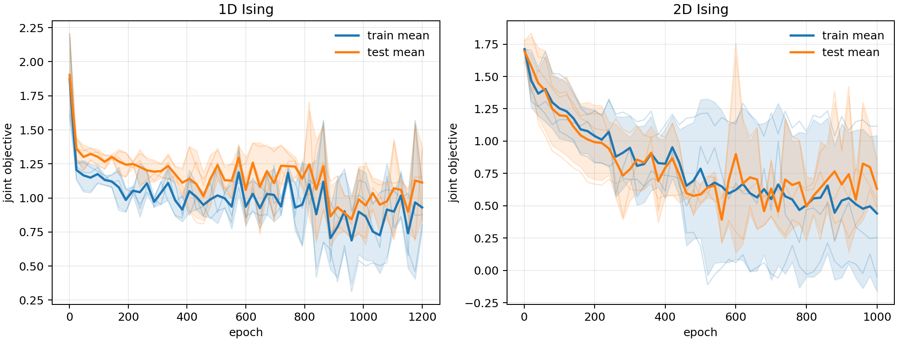
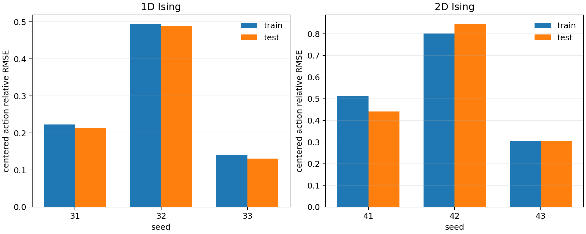

# Recurrent RG Network

一个从无标签构型系综联合学习实空间粗粒化、有效理论坐标、理论 RG 流和神经作用量
的研究原型。当前验证系统是周期边界的 1D 与 2D 零场 Ising 模型；耦合常数
$J$ 不进入训练损失，只在训练结束后用于物理评估。

## 思想来源

### 2018 RSMI：学习应该保留什么自由度

Koch-Janusz 和 Ringel 在
[*Mutual information, neural networks and the renormalization group*](<references/Mutual information, neural networks and the renormalization group.pdf>)
中学习条件分布 $P_\Lambda(H\mid V)$，将局域区域 $V$ 压缩为 coarse variable
$H$，并最大化 $H$ 与 buffer 外环境 $E$ 的互信息 $I(H:E)$。有限容量的 $H$
因而优先保留能够预测长程物理的信息，而不是只记录局域涨落。该方法在每个 RG
step 重新训练 kernel，并在 Ising 模型中重新发现 Kadanoff block spin，在 dimer
模型中识别出长波长 electric-field 自由度。

它主要回答：**从当前尺度的构型中，下一尺度应该保留什么？**

### 2026 PRL：学习有效作用量泛函

Holland 等人在
[*Machine-Learned Renormalization-Group-Improved Gauge Actions and Classically Perfect Gradient Flows*](<references/Machine-Learned Renormalization-Group-Improved Gauge Actions and Classically Perfect Gradient Flows.pdf>)
中研究四维 SU(3) 格点规范场。其 RG blocking 预先给定，通过 fixed-point saddle
equation 生成监督信号，再使用严格 gauge-equivariant、平移共享且局域的卷积网络
学习

$$
U\longmapsto A_{\mathrm{FP}}[U].
$$

网络输入一个规范场构型，输出一个标量作用量；训练同时使用作用量值及其关于规范
链路的导数。其重点不是学习 RG kernel，而是高效表示难以显式参数化的 fixed-point
action，使粗晶格也能较好地保持连续极限物理。

它主要回答：**给定某个尺度的构型，怎样表示这个尺度上的有效作用量？**

## 我们想做什么

RSMI 主要学习构型 coarse-graining，2026 PRL 主要学习有效作用量。我们希望在两者
之间显式加入一个理论状态 $\mathbf g_k$，把一次 RG 组织成三个相互约束的层次：

$$
\boxed{X_k\ \text{构型层}}
\quad\longleftrightarrow\quad
\boxed{\mathbf g_k\ \text{理论层}}
\quad\longleftrightarrow\quad
\boxed{A_k\ \text{作用量层}}.
$$

### 1. $X$：构型层

$X_k$ 是尺度 $k$ 上的一个具体构型；构型系综记为

$$
\mathcal D_k=\{X_k^{(1)},\ldots,X_k^{(B)}\}.
$$

可学习 kernel $C_\theta$ 在构型空间执行粗粒化：

$$
X_{k+1}=C_\theta(X_k).
$$

这一层继承 RSMI 的思想：利用 $I(H:E)$ 判断 coarse variable 是否保留了长程信息。
当前模型在所有尺度复用同一个局域 kernel；这比原始 RSMI 每层重新训练 kernel
施加了更强的“尺度自治”假设。

### 2. $\mathbf g$：理论层

$\mathbf g_k$ 表示控制尺度 $k$ 构型统计的低维有效理论坐标。单个构型不能唯一决定
$\mathbf g$：不同理论都可能生成同一个 $X$。因此 encoder 的正确解释是从同一理论
产生的构型系综进行统计推断：

$$
Q_\eta(\mathcal D_k)\approx q_\eta(\mathbf g_k\mid\mathcal D_k).
$$

当前实现输出该后验的点估计。共享的理论 RG cell 随后循环推进

$$
\mathbf g_{k+1}=R_\psi(\mathbf g_k)
=\mathbf g_k+F_\psi(\mathbf g_k).
$$

在一维最近邻 Ising 中，真实理论可由标量 $J_k$ 描述；通用模型允许
$\mathbf g\in\mathbb R^m$，以容纳 RG 生成的多种局域、长程或多体耦合。

### 3. $A$：作用量层

神经作用量把抽象的理论坐标重新连接到可观测的构型分布：

$$
A_\phi(X_k,\mathbf g_k),\qquad
p_\phi(X_k\mid\mathbf g_k)
=\frac{\exp[-A_\phi(X_k,\mathbf g_k)]}{Z(\mathbf g_k)}.
$$

这一层继承 2026 PRL 的核心思想：使用满足局域性和空间参数共享的网络表示复杂
有效作用量。它同时为 $\mathbf g_k$ 提供物理约束——如果 $\mathbf g_k$ 确实描述
该尺度的理论，那么 $A_\phi$ 应当重现这一尺度的构型统计。当前无标签管线使用局域
条件概率或 score matching 训练它，不需要真实 action 标签或全局配分函数。

## 三层如何闭合

构型空间的 RG 与理论空间的 RG 应给出一致的下一尺度：

$$
D\text{: 系综分布，}B\text{ 系综，}N\text{ 个格点，形状 }[d,B,N]\\
\mathbf g\text{: }m\text{ 个物理量，形状 }[d,m]
$$

$$
\begin{array}{ccc}
\mathcal D_k & \xrightarrow{\ C_\theta\ } & \mathcal D_{k+1} \\
\downarrow Q_\eta & & \downarrow Q_\eta \\
\mathbf g_k & \xrightarrow{\ R_\psi\ } & \mathbf g_{k+1}.
\end{array}
$$

即

$$
R_\psi(Q_\eta(\mathcal D_k))
\simeq
Q_\eta(C_\theta(\mathcal D_k)).
$$

因此模型不是只学习一个压缩器或一个 action 网络，而是同时要求：

1. $X$ 层保留远程信息；
2. $\mathbf g$ 层形成可递归的理论流；
3. $A$ 层能够解释每个尺度的构型统计；
4. 三层对同一次 RG 给出相容描述。

## 当前主线：configuration-only QCR

当前探索阶段暂时关闭 RSMI 与作用量 A，只研究最小的 Q--C--R 闭环：

$$
\mathcal D_k\xrightarrow{C}\mathcal D_{k+1},\qquad
\mathbf g_k=Q(\mathcal D_k),\qquad
\mathbf g_{k+1}=R(\mathbf g_k).
$$

模型只知道哪些构型属于同一个 ensemble，不知道生成该 ensemble 的耦合 $J$、
$J$ 的顺序、临界点或相标签。 $J$ 只在训练完成后用于坐标标定和物理评价。

二维零场 Ising 的每个有限 batch view 都严格包含 $(X,-X)$ 对，使 Q 不能利用
自发磁化的正负号区分理论。Wolff sampler 在记录构型时也随机化全局自旋朝向，
避免有序相中的采样扇区锁定；这不改变能量、关联函数等偶观测量。

当前 QCR objective 包含：

$$
\mathcal L_{\mathrm{QCR}}=
\lambda_Q\mathcal L_Q+
\lambda_s\mathcal L_{\mathrm{split}}+
\lambda_d\mathcal L_{\mathrm{separation}}+
\lambda_c\mathcal L_{\mathrm{comm}}.
$$

- **$\mathcal L_Q$（锚点， $\lambda_Q=1$，2D 下为 2）**：在微观层 $\mathcal D_0$ 固定理论坐标 $\mathbf g_0$。将 $\mathcal D_0$ 均分为两半 $\mathcal D_0^A,\mathcal D_0^B$，令 $\mathbf g_0^A=Q(\mathcal D_0^A)$， $\mathbf g_0^B=Q(\mathcal D_0^B)$， $\mathbf g_0=(\mathbf g_0^A+\mathbf g_0^B)/2$。则

  $$
  \mathcal L_Q = 10\cdot\underbrace{\|\mathbf g_0^A-\mathbf g_0^B\|^2}_{\text{子集一致性}}
  +\underbrace{\Vert\mathrm{ReLU}(1-\sigma(\mathbf g_0))\Vert^2}_{\text{非坍缩}}
  +\underbrace{\Vert\mathrm{offdiag}(\mathrm{Cov}(\mathbf g_0))\Vert_F^2}_{\text{去相关}}
  +\underbrace{(1-\mathrm{corr}(d(\mathbf g_0),\,d(\mathbf p_0)))}_{\text{局域几何}}
  $$

  其中 $\sigma(\mathbf g_0)$ 是 $\mathbf g_0$ 沿 system 维的标准差向量（2D 版改用 $\|\sigma(\mathbf g_0)-1\|^2$）， $\mathbf p_0$ 是 $\mathcal D_0$ 的局域 spin pattern经验分布（1D: 3-spin pattern, 2D: $2\times2$ plaquette）， $d(\cdot)$ 为上三角成对欧氏距离， $\mathrm{corr}$ 为 Pearson 相关系数（等价于 $1-\rho$，其中 $\rho$为 Spearman 秩相关在连续极限下的替代）。

- **$\mathcal L_{\mathrm{split}}$（粗粒化一致性， $\lambda_s=5$）**：对所有 $k\ge1$，要求同一系综的子集在粗粒化后仍编码一致：

  $$
  \mathcal L_{\mathrm{split}}=\frac{1}{(K-1)d}\sum_{k=1}^{K-1}
  \VertQ(\mathcal D_k^A)-Q(\mathcal D_k^B)\Vert^2
  $$

  其中 $K$ 为总层数， $d$ 为理论坐标维度。本质上是 $\mathcal L_Q$ 中子集一致性的多层级推广。
  
- **$\mathcal L_{\mathrm{separation}}$（自适应防坍缩， $\lambda_d=2$）**：定义每层 $\mathbf g_k=(\mathbf g_k^A+\mathbf g_k^B)/2$ 的统计量：

  $$
  \begin{aligned}
  \sigma_{\text{pairwise},k} &= \mathrm{mean}(\|\mathbf g_k^{(i)}-\mathbf g_k^{(j)}\|^2)_{i<j} \\[2pt]
  \sigma_{\text{split},k} &= \tfrac12(\|\mathbf g_k^A-\mathbf g_k^B\|^2) \\[2pt]
  \mathrm{SNR}_k &= \frac{\mathrm{spread}(\mathbf g_k)}{\sqrt{\sigma_{\text{split},k}}} \\[2pt]
  s_k &= \mathrm{ReLU}\!(\sigma_{\text{pairwise},k}-2\cdot\sigma_{\text{split},k})
  \end{aligned}
  $$

  对 $k\ge1$，当前一层 $\mathrm{SNR}_{k-1}>2$ 时才激活惩罚（gate 从 0 线性升到 1，在 $\mathrm{SNR}_{k-1}=3$ 时饱和），并要求当前层保留上一层的至少 5% 可分辨信号：

  $$
  \mathcal L_{\mathrm{separation}}=\sum_{k=1}^{K-1}
  0.5^{\,k-1}\cdot\mathrm{gate}(\mathrm{SNR}_{k-1})\cdot
  \mathrm{ReLU}\!(0.05\cdot s_{k-1}-s_k)
  $$

  其中 $\mathrm{spread}(\mathbf g_k)=\sqrt{\mathrm{mean}(\sigma_{\dim}(\mathbf g_k)^2)}$。gate 与 target signal 均 detach，不反向传播梯度。衰减 $0.5^{k-1}$ 反映物理直觉：更深层携带更少可分辨信息，防止 RG 流在中途坍缩为一个点。

- **$\mathcal L_{\mathrm{comm}}$（对易子， $\lambda_c=5$）**：要求交换图 $\mathcal D_k\to\mathbf g_k\to R(\mathbf g_k)$ 与 $\mathcal D_k\to\mathcal D_{k+1}\to\mathbf g_{k+1}$闭合：

  $$
  \mathcal L_{\mathrm{comm}}=\frac{1}{(K-1)d}\sum_{k=0}^{K-2}
  \VertR(\mathbf g_k)-\mathbf g_{k+1}\Vert^2
  $$

  这保证粗粒化 $C$ 在构型空间中的信息压缩，与 $R$ 在理论空间中的流是对易的——「先编码再推演」等于「先粗粒化再编码」。

这里没有使用 RSMI、真实 action、 $J$ 标签或临界点标签。

## 当前模型

系统相关结构已拆成可替换 adapter：

| 接口 | 当前实现 | 用途 |
|---|---|---|
| `LatticeGeometry` | 1D chain、2D square、3D cubic | 局域邻域、周期边界和 blocking |
| `FieldHead` | binary、categorical、continuous | 定义 coarse variable 的场空间 |
| `RSMICritic` | InfoNCE | 处理离散、连续或多通道环境 |
| `LocalConditional` | binary PL、categorical PL、continuous score matching | 无配分函数地训练局域 action |

通用核心位于 `recurrent_rg/model_nd.py`。1D 和 2D Ising 分别通过
`model1d.py` 与 `model2d.py` 组装相同核心。理论坐标允许为
$\mathbf g\in\mathbb R^m$，不再写死为标量。

### 对称性的当前处理

默认 learned kernel、theory encoder 和 action 不显式施加 $Z_2$ 不变性或等变性：

- kernel 是带 bias 的普通局域 MLP；
- 不计算 $[f(X)+f(-X)]/2$；
- Wolff 和随机整体自旋翻转只用于 Ising 数据采样/增强；
- 换到其他物理系统时可以替换 sampler 和 augmentation，而不修改通用核心。

Binary 与 categorical kernel 使用 straight-through estimator。RSMI critic 的前向输入
是实际传播的 hard coarse field，而不是 relaxed logit，防止网络把信息藏在 RG 迭代
不会读取的连续幅值中。

## 张量与尺度

统一输入格式为

```text
[systems, samples, *spatial_shape, field_channels]
```

默认 blocking factor 为 2：

- 1D： $N\rightarrow N/2$；
- 2D： $L^2\rightarrow(L/2)^2$；
- 3D： $L^3\rightarrow(L/2)^3$。

默认局域感受野宽度为 3。2D 使用重叠 $3\times3$ 窗口，3D geometry 使用
$3\times3\times3$ 窗口。窗口宽度与 blocking factor 是不同概念：宽度决定局域
信息范围，blocking factor 决定尺度缩小比例。

以二维标量场为例，Q 的主要张量流为：

```text
ensemble                 [systems, samples, L, L, 1]
3x3 periodic patches  -> [systems, samples, L, L, 9]
shared local MLP       -> [systems, samples, L, L, features]
sample+space average   -> [systems, features]
theory head Q          -> [systems, theory_dim]
```

C 将空间尺寸从 $L\times L$ 变为 $(L/2)\times(L/2)$；R 只作用于
`[systems, theory_dim]`，并在所有尺度复用同一个 residual MLP。

## 完整 QCRA 目标（非当前 QCR-only 实验）

当前训练目标为

$$
\mathcal L=
-\lambda_I\widehat I_{\rm NCE}(H;E)
+\lambda_e\mathcal L_{\rm ensemble}
+\lambda_g\mathcal L_{\rm gauge}
+\lambda_r\mathcal L_{\rm rollout}
+\lambda_c\mathcal L_{\rm comm}
+\lambda_A\mathcal L_{\rm conditional}.
$$

- `RSMI`：保留局域 block 与 buffer 外环境的长程信息；
- `ensemble`：同一系统的两个样本子集应得到相同理论坐标；
- `gauge`：固定 latent 坐标的平移、尺度和多维协方差自由度；这里的 gauge 指
  潜空间坐标规范，不是 SU(3) 规范场对称性；
- `rollout`：递归理论流应与每一尺度的直接编码一致；
- `commutator`：要求 $R(Q(\mathcal D_k))\approx Q(C(\mathcal D_k))$；
- `conditional`：通过局域条件分布训练 action，不计算全局配分函数。

Ising 的单点伪似然为

$$
-\log p_\phi(s_i\mid X_{\setminus i},\mathbf g)
=\mathrm{softplus}\!\left[
A_\phi(X,\mathbf g)-A_\phi(X^{(i)},\mathbf g)
\right].
$$

局域 action 只重算受该自旋翻转影响的窗口。Potts-like 场枚举单点 categorical
状态，连续场 adapter 使用 denoising score matching。

## 运行

安装与测试：

```bash
python -m pip install -e ".[dev]"
pytest
```

单个 1D/2D 无标签实验：

```bash
python experiments/unsupervised_recurrent_rg_ising_1d.py
python experiments/unsupervised_recurrent_rg_ising_2d.py
```

当前 QCR-only 二维实验：

```bash
python experiments/joint_qcr_ising_2d.py \
  --output-dir results/joint_qcr_ising_2d
```

当前三 seed 实验使用 64-pair InfoNCE。并行运行时建议限制 BLAS 线程，避免多个
PyTorch 进程过度订阅 CPU：

```bash
env OMP_NUM_THREADS=1 MKL_NUM_THREADS=1 OPENBLAS_NUM_THREADS=1 \
  python experiments/unsupervised_recurrent_rg_ising_2d.py \
  --seed 41 \
  --max-rsmi-pairs 64 \
  --output-dir results/recurrent_rg/multiseed_2d/seed_41
```

重新生成多 seed 汇总图：

```bash
MPLBACKEND=Agg python experiments/summarize_ising_multiseed.py
```

`python -m recurrent_rg` 仍保留早期 supervised/pseudolikelihood 对照入口，但不属于
当前 configuration-only 通用管线。

## 当前三 seed 结果

1D 使用 seeds 31/32/33、1200 epochs；2D 使用 seeds 41/42/43、1000 epochs。
每条 loss 曲线在固定且均匀覆盖耦合区间的 8 个系统 × 16 个样本上评估。

| 模型 | 最终 train loss | 最终 test loss | train action 相对 RMSE | test action 相对 RMSE |
|---|---:|---:|---:|---:|
| 1D Ising | $0.9303\pm0.1606$ | $1.1128\pm0.2625$ | $0.2858\pm0.1853$ | $0.2782\pm0.1881$ |
| 2D Ising | $0.4401\pm0.6040$ | $0.6312\pm0.1963$ | $0.5402\pm0.2483$ | $0.5309\pm0.2808$ |

总目标包含负的 RSMI 项，因此 loss 可以小于零。作用量相对误差定义为

$$
\epsilon_A=
\sqrt{\frac{\sum_{a,x}
[\widetilde A_{\rm learned}(x)-\widetilde A_{\rm exact}(x)]^2}
{\sum_{a,x}\widetilde A_{\rm exact}(x)^2}},
\qquad
\widetilde A=A-\langle A\rangle_{\rm ensemble}.
$$

中心化只去除 action 的不可观测加性常数，没有进行后验尺度拟合。逐 seed 数值、
完整 history 与配置见 `results/recurrent_rg/multiseed_summary.json`。





## 结果解读与当前边界

- 1D action 平均相对误差约 28%，2D 约 53%；两者均有显著 seed 敏感性。
- 联合 loss 与 action 误差并不单调对应；2D seed 42 的最终 train loss 最低，但
  test action 相对误差约 85%。
- loss 曲线后期波动明显，最终 epoch 经常不是最低 test-loss epoch；后续应加入
  固定验证集的 early stopping 和 checkpoint selection。
- 修正 hard-field RSMI 后，2D 三个 kernel 的相对 RSMI efficiency 为
  0.945、0.978、0.970，没有 hard-kernel 坍缩。
- 三维 geometry 与模型前向/反向已经有测试，但尚未加入正式 3D sampler 和三维
  物理训练结果。
- 当前只验证了局域、平移共享的 action。具有规范约束、守恒量、长程作用或拓扑
  自由度的系统仍需要相应 geometry、field 和 conditional adapter。

因此当前结果证明了无标签联合训练管线可以运行，但还不能说明 action 与 RG kernel
已经稳定、唯一地被识别。这是下一阶段应优先解决的问题。

## 仓库结构

```text
recurrent_rg/              通用模型、geometry、field/conditional adapter 和 loss
experiments/               1D/2D 无标签训练、RSMI 辅助实验和多 seed 汇总
tests/                     1D/2D/3D 形状、PL、场类型、梯度与 hard-field 测试
results/recurrent_rg/      JSON、曲线和当前六个 checkpoint
reproduction/              规范场工作的独立复现
references/                本地论文与文献说明
archive/legacy_ising/      早期原型与消融，不属于当前 API
```
