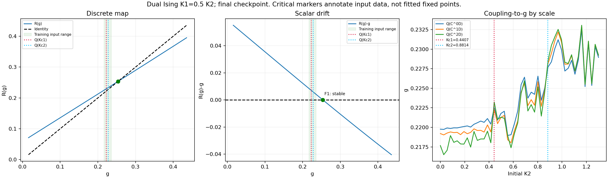
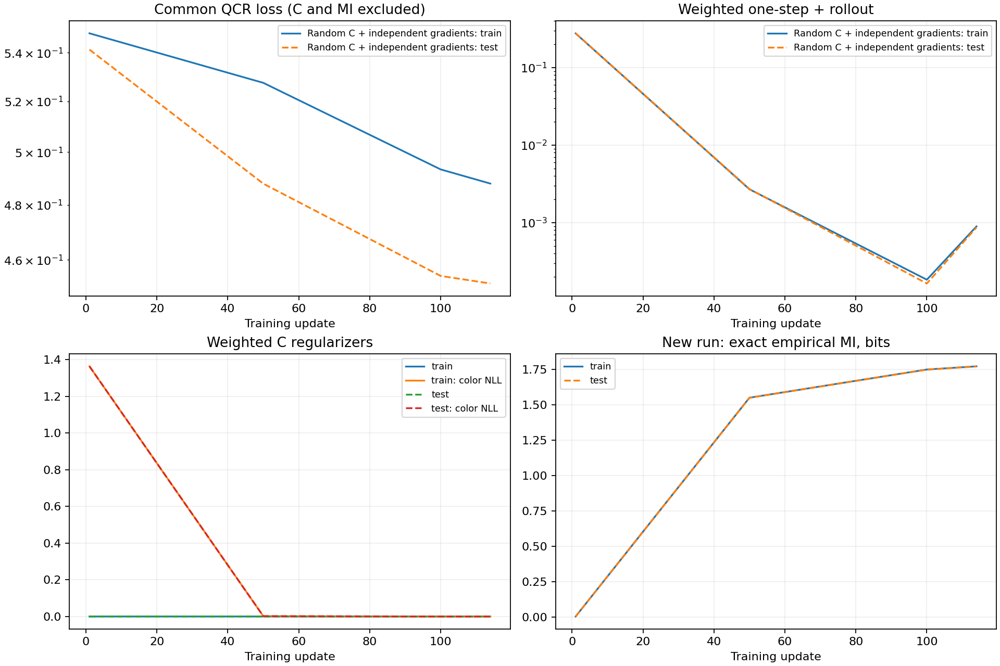

# 双 Ising：K1=K2/2，默认仿射重构的从头训练

日期：2026-10-09。用户要求将重构头 loss 设为默认，并在双 Ising 单参数扫描上
检查三个相、两个相变。此处是两套不耦合的二维经典 Ising，不是三值 spin-1 或四态 Potts。

## 默认变更与历史兼容

新模型默认增加共享仿射图案分布 decoder；Q 使用10重构＋20微观子集一致性＋5粗尺度一致性。
每次更新归一化 decoder 列范数，不强迫满秩；不做PCA、不输入K或相标签。
C 保持-2经验完整壳层MI＋2逐系综variance-floor（ratio1）＋1均匀块保色；
R 保持5一步＋5全可用尺度rollout，Q/C/R独立梯度同步更新。

旧配置反序列化和checkpoint加载不自动添加decoder；旧resume保留原目标。
默认入口的新训练在字段省略时开启重构，显式affine_reconstruction=false保留几何对照。
ModelConfig的直接新建默认值为true。多维g时同样使用单位列范数，不新增协方差白化。

## 数据和模型

本次明确按K1=K2/2，而不是历史K2=K1/2；只是两层互换，横轴及耦合标签均为K2。
K2在[0,1.3]均匀取48点，K1=0.5K2。每点2个独立副本，每组64构型；
完整耦合点划分为64训练、32测试系综。Swendsen–Wang两层独立采样，
burn1024、spacing16，seed91，不额外做二值翻转增强。
L36→12→4，不重叠3×3/stride3概率C，联合自旋按四态one-hot编码。

数据指纹：c044a920b89e0179291c65ade365b022bef326da3896829ad24d1182c2b5a5b2。
dim g=1，hidden96，Q6729（含512参数decoder）、C13252、R9601，共29582参数。
随机初始化全部Q/C/R及decoder方向；decoder偏置仅用随机C下训练分布均值校准，
不继承历史权重、不冻结C、不作核选择或预训练。

四态3×3输入有262144种图案；旧稀疏计数实现本来支持该规模，此次将显式资源上限
从65536提高到262144，完整壳层、buffer1及经验MI公式不变。训练仍评价完整概率表，
并非截断环境或改用InfoNCE。报告只列4个均匀块概率，省略大型真值表打印。

理论参考扫描边界是K2=Kc≈.4406868与K2=2Kc≈.8813736。
中间相仅K2层有序；其固定点在完整二维耦合平面而不一定在初始比值扫描线上，
因此初始单参数扫描并不自动保证dim g=1在所有粗尺度闭合。

采样审计的两副本平均绝对磁化近似为：

| K2 | K1 | sigma层 | tau层 |
|---:|---:|---:|---:|
| .1936 | .0968 | .029 | .036 |
| .6362 | .3181 | .068 | .982 |
| 1.1617 | .5809 | .969 | 1.000 |

数据中三个相可辨认；这不是用标签训练Q或C的依据。

## 续训与二维潜空间：最新状态

dim g=1 的114步短测已按相同设置恢复Adam及全部随机状态，续训至**累计1200步**，
不是额外1200步，也不是R-only。最终目录为
`results/dual_ising2d_K1halfK2_g1_affineQ_joint_resume1200_seed91`。
搜索范围[-.32937,.56812]内只有一个排斥子g=.266437，R导数1.309205，
微观K2单分支插值=.917964；接近第二理论边界.881374，但偏高约4.15%。
另一个吸引点g=-.216038、R导数.719804，位于TRAIN输入范围外、无微观插值。
第一个理论边界的排斥结构尚未恢复，不能称为两个相变点均已成功。

同一数据指纹下正在从头训练dim g=2、1200步；配置为
`configs/dual_ising2d_K1halfK2_g2_affineQ_joint_1200_seed91.json`。
hidden96，batch8×64，其余默认Q/C/R目标、随机初始化和独立梯度不变。
Q/C/R参数为7082/13252/9794，总30128（含768参数Q decoder，不含A）。
这里只改变潜维度，不扩充为完整二维K1/K2采样。最终报告待已有管线完成，
临时检查点不能当作最终实验结论；二维临界结构也不必都是全方向排斥子。

## 命令与短测结果

```bash
python -m scripts.generate_dual_ising2d \
  --output data_cache/dual_ising2d_K1halfK2_L36_n64_seed91 \
  --length 36 --samples 64 --replicas 2 --scan-axis K2 --ratio .5 --skip-probes

python -m experiments.rsmi_separate_qcr \
  --config configs/dual_ising2d_K1halfK2_g1_affineQ_joint_1200_seed91.json \
  --output results/dual_ising2d_K1halfK2_g1_affineQ_joint_1200_seed91 \
  --max-wall-seconds 540

python -m scripts.report_scalar_joint \
  --run results/dual_ising2d_K1halfK2_g1_affineQ_joint_1200_seed91
python -m scripts.plot_dual_ising_scalar \
  --run results/dual_ising2d_K1halfK2_g1_affineQ_joint_1200_seed91
python -m scripts.report_mi_training \
  --run results/dual_ising2d_K1halfK2_g1_affineQ_joint_1200_seed91
```

Adam .001，system batch8×64，threads2。四态的计算量大，batch小于之前32；
本次不是历史双Ising的严格复现，数据尺寸、块大小、层顺序、batch及Q目标均有差异。

目录名1200表示目标，不是完成数。短测实际完成114次更新，训练527.8秒，
准备＋训练549.0秒，时限结束后正常保存；报告时间另计。
不能把114步当作1200步的相图结论。

尚未恢复两个排斥子。搜索区间[.015879,.435735]只有吸引点g=.253722、
R导数.771805；它在观察到的训练输入范围之外，且没有微观K2插值。
微观g集中在约.216–.234，Q尚未稳定展开三个相；测试Spearman约.814/.822/.839。
一步0→1 NRMSE=142.94%、1→2=133.43%，两步rollout=233.08%，
分母为TRAIN目标标准差约.005，而非重新缩放坐标后的误差。
绝对closure loss很小并不意味着闭环良好。

末步测试重构MSE=.044991（加权.449908），内部已乘10的anchor=.000341747，
coarse=.000037724，一步=.000057022，多步=.000116556；
C保色NLL≈.00004082，逐系综variance-floor≈.000001131，经验MI≈1.7719bit。
Q目标仍在下降。此短测不足以区分训练不足、重构轴优化问题与跨尺度闭合性限制，
不能把失败归因于某个模块已达到能力上限，也不应只因绝对R loss小就冻结Q。





全部相关和完整测试套件通过；新增四态3×3完整壳层计数/梯度测试及默认/历史兼容测试。
