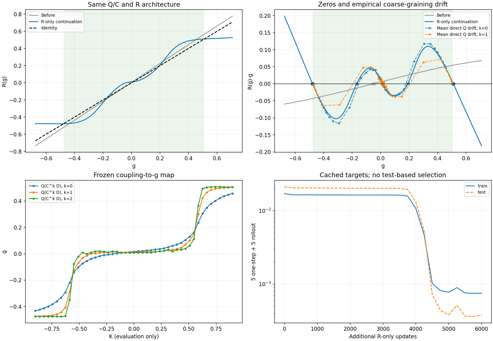
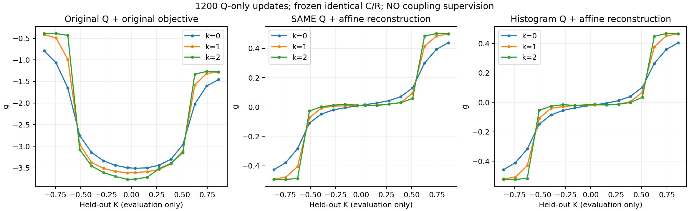
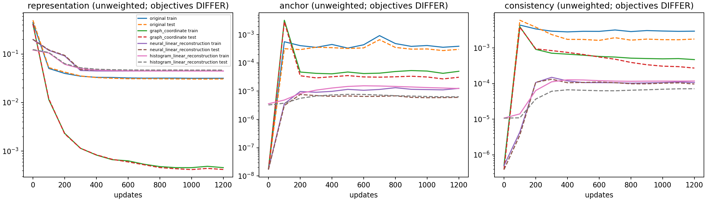
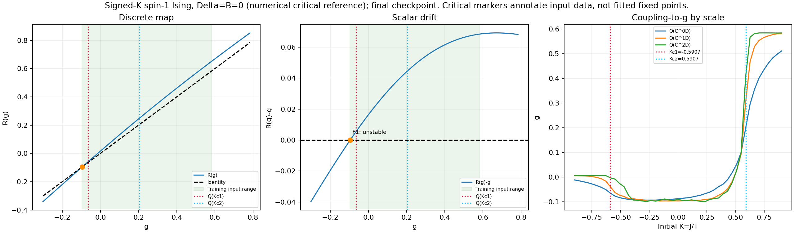
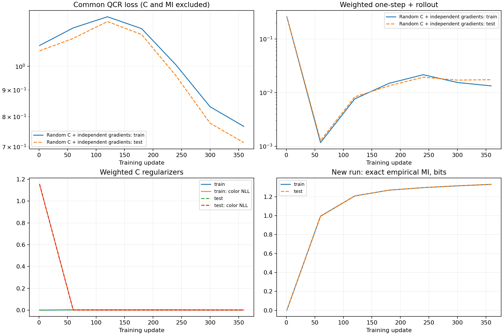
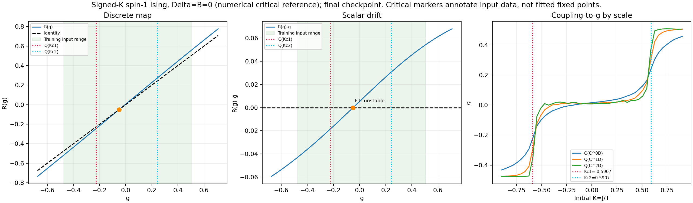
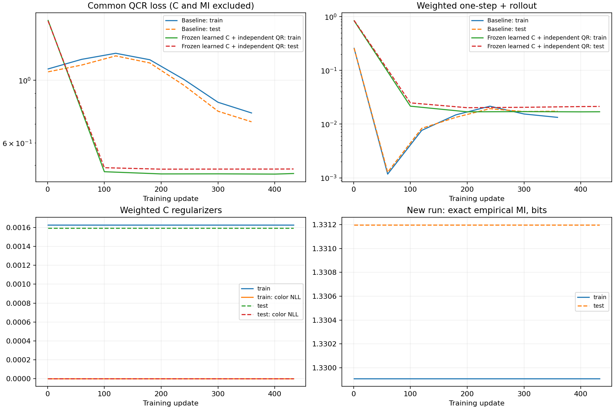
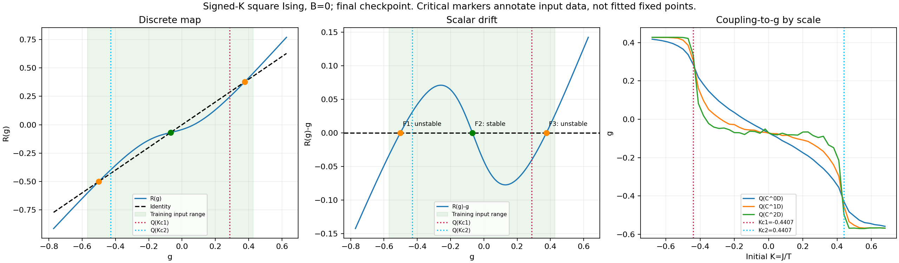
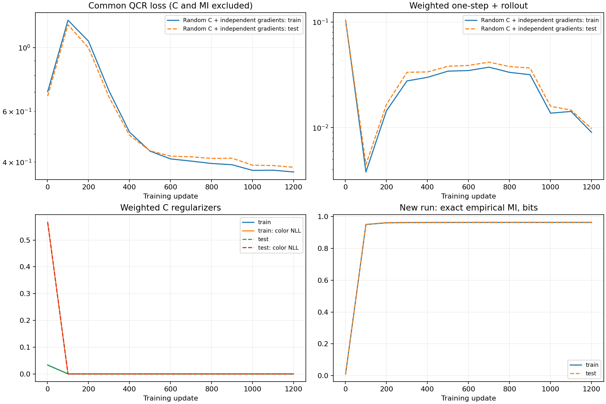

# Spin-1 Q 的 U 形折叠诊断与修复（2026-10-08）

最初是用户授权的 **Q-only 结构／目标消融**，不训练 C/R，不用耦合标签选图端点、初始化、训练或选检查点；后续各阶段的训练模块单独标明。
2026-10-09 用户已将共享仿射重构设为新训练默认，但冻结 C、PCA 初始化及 R-only 续训仍是显式诊断，不是默认配方。以下保留各阶段当时的实际配置及结果，不追溯改写历史。

## 最新补充：冻结展开的 Q/C，只继续训练 R（2026-10-09）

用户授权对433步的冻结C/QR结果做R-only诊断。Q及其decoder、C逐参数锁定，
继承原R权重和Adam动量、step计数；R仍为9601参数的原残差Tanh MLP。
原一步/多步闭环平方误差形式和5/5权重、恒定学习率.001均保持不变。
本次有明确的数据目标差异：使用原full_report保存的62个TRAIN完整系综的
固定Q轨迹，全批次拟合；不是原随机batch及两个半系综Q输出均值。
测试32个不同K的系综只用于评估，没有标签监督、测试选检查点或R结构修改。

```bash
python -m experiments.rsmi_separate_qcr \
  --source results/spin1_signedK_g1_affineQ_frozenC_pca_QR_1200_seed91 \
  --output results/spin1_signedK_g1_affineQ_frozenQC_R_continue6000_seed91 \
  --r-only-continue --epochs 6000 --max-wall-seconds 540
```

此显式入口的epochs表示**追加R更新数**；默认训练不启用它。
实际追加6000步，含目标校验、训练及绘图约44.2秒；Adam step由433变为6433。
Q/C最大参数差均为0，核对缓存的TRAIN编码与当前checkpoint重新计算值逐项一致。
不重新生成物理数据，不把TEST编码或K标签放入优化目标。

搜索范围[-.6754,.7089]内得到：

| g* | R'(g*) | 稳定性 | 微观K插值 | 在观察到的TRAIN R输入范围内 |
|---|---:|---|---:|---|
| -.477979 | .040087 | 吸引 | 无微观插值 | 否 |
| -.167730 | 1.890856 | 排斥 | -.561587 | 是 |
| .013348 | .200437 | 吸引 | -.034757 | 是 |
| .190939 | 1.848119 | 排斥 | .562658 | 是 |
| .510441 | .102112 | 吸引 | 无微观插值 | 否 |

两个排斥子是独立根，各有单个微观插值分支；相对此前采用的数值参考
±.59067仍有约4.9%的偏移，不能称为精确临界位置。
两侧吸引子略超出TRAIN输入范围，是近邻外推，微观g(K)也未覆盖它们。

测试一步0→1 NRMSE从14.948%降为2.242%，1→2从10.347%降为1.977%；
两步rollout从21.386%降为2.058%。分母保持原TRAIN目标标准差，未重新缩放g。
最终固定目标TRAIN/TEST加权closure loss为.0007507/.0003788。
3次全新C抽样seed9001–9003的一步0→1误差2.19–2.25%、两步1.98–2.16%，
说明改善不局限于拟合时的C抽样，但仍是同一批微观测试构型、同一训练种子。

追加1000及3000步时仍只有一个排斥子；约3750–4500步出现明显的非线性拟合改善。
该结果证明现有R结构能够拟合这组冻结表示中的两条分界，支持之前R优化不足的诊断；
由于目标缓存和全批次变化，不能把它当成原随机联合训练“仅增加epoch”的严格复现，
也不能因此宣称Q已达到所有尺度上的精确RG充分性。



完整数值、指纹和抽样审计见该目录的report.json、manifest.json、history_progress.json。

## 结论

当前三值自旋 signed-K 数据的 U 形折叠已在测试集上消除。
**不需要增加原 Q 的容量或更换结构**：相同的原神经 Q、初始权重和批次，
把距离匹配换成有尺度约束的仿射分布重构即可展开。

不能由此断言原几何目标的全局最优必然折叠。事后只用训练集拟合统一的正比例系数，
把展开表示换到原目标的单位后，其原目标测试值约 0.0908，明显低于原折叠解的 0.3201。
证据支持原训练落入折叠局部解；重构目标改变了优化路径。

## 原因定位

- C 后正、负强耦合构型仍分别是同色块、棋盘格。输入信息没有消失。
- Q 的局域网络保留有序 3x3 图案，但近线性的局域映射经平移平均后容易突出单点颜色占比。
  三值模型的零态占比对正负 K 近似对称，容易形成初始化／优化偏向。
- 原 12 维池化特征仍能线性读出 K；不是硬性的表示能力不足。
- 原 `relative_local` 目标严重低权重处理远距离跨分支对，并只提供无方向的距离梯度。
  这是可能的优化障碍，不是已经证明的全局折叠偏好。

## 最小成功目标

令 p_k 为有向 2x2 分类图案概率，g_k 为原 Q 的输出：

\[
L_{\rm rep}=\frac1{3}\sum_{k=0}^{2}\|p_k-b-Wg_k\|_2^2,
\qquad \|W\|_2=1.
\]

对 histogram bins 求和，对系综／尺度取平均。W、b 是可训练的仿射解码器，
每次更新后把 W 列归一化；本实验 dim g=1，避免 g 缩小、W 放大的尺度退化。
这里是原始概率的平方重构，不是 softmax、能量拟合、RSMI 或 K 监督。

\[
L_Q=10L_{\rm rep}+20L_{\rm micro\ subset}+5L_{\rm coarse\ subset}.
\]

微观和粗尺度子集项仍分别比较同系综随机 32/32 两半的 g。
两组重构的解码轴与训练集 PCA 主轴余弦均超过 0.99996，测试重构残差
只比训练集 PCA 的解析 rank-1 参照高约 0.06%。

## 四组配对实验

同一 seed91、1200 次更新，Adam 0.001、system batch32、64 构型，
62 训练／32 测试系综（31／16 个互不重叠的 K，每 K 两个副本）。
L36→12→4，源概率 3x3 C 冻结，缓存检查为精确 one-hot。
四组训练用时约 272 秒；所有尺度共享 Q，无尺度编号或耦合输入。

| 方案 | 测试 Spearman 绝对值 k=0/1/2 | 回折变化占比 k=0/1/2 |
|---|---|---|
| 原神经 Q＋原几何项 | .1424 / .2019 / .1565 | 43.0% / 42.1% / 42.5% |
| 同一神经 Q＋仿射重构 | .9985 / .9971 / .9473 | 0 / 0 / .78% |
| 原神经 Q＋图坐标回归 | .9985 / .9971 / .9605 | 0 / 0 / .46% |
| 原始图案直方图线性 Q＋仿射重构 | .9985 / .9956 / .9627 | 0 / .02% / 1.10% |

回折变化占比定义为按测试 K 排列、同 K 副本取均值后，
min(正向总变化,反向总变化)/总变化；不是严格单射证明。
神经重构组的相对子集 RMS 为约 1.05%／2.47%／3.97%。

图坐标是额外无标签对照：仅微观训练 p 的 4-NN 图，图直径两端的测地距离之差给出坐标；
粗尺度／测试节点独立附着，不给训练图添加捷径。
这是区间型流形假设，不是一般多维或分叉空间的解法；最小修复并不需要采用它。
图回归对两个子集分别回归全系综目标，因此隐含额外子集项；有效微观／粗尺度权重为
20.8333／6.6667，不能把四组不同目标的 loss 数值直接排名。

## 复现和推理检查

```bash
python -m experiments.rsmi_separate_qcr --q-unfolding \
  --source results/spin1_Qonly_loss_candidates_exact_2400_seed91/baseline.pt \
  --frozen-cache results/spin1_Qonly_cache_exact_seed91 \
  --epochs 1200 --output results/spin1_Qunfolding_1200_seed91

python scripts/validate_q_unfolding.py \
  --run results/spin1_Qunfolding_1200_seed91 --draws 8

python -m scripts.audit_q_unfolding_objectives \
  --run results/spin1_Qunfolding_1200_seed91 \
  --cache results/spin1_Qonly_cache_exact_seed91
```

产物目录已存在，重跑应指定新的 output，避免覆盖历史结果。
8 次新 C 抽样 seed9200–9207 下神经重构组的平均相关性为
.9985／.9971／.9495，回折为 0／0／.76%，强耦合正负分支保持分离。
这仍是同一批测试微观构型，只检验粗粒化随机性；不能替代新物理数据或多训练种子验证。





R 保持源权重，未拟合新 g 坐标，因此本次不提供新的 R 不动点结论。
下一步若采用该目标，需要在完整 QCR 上单独验证闭合性和相图，不能从 Q 展开直接宣布 RG 成功。

## 完整 QCR 短训练（2026-10-09）

用户授权把最小成功的仿射 MSE 重构目标接入完整训练；本次从随机 Q/C/R 初始化，
不继承 Q-only 权重、不冻结 C、不预训练 kernel。数据、隐藏层96、g维度1、3x3/stride3
和 C/R 默认目标保留，Q 用20微观子集＋5粗尺度子集＋10重构。
该阶段新增 `affine_reconstruction=true` 时是显式实验选项，**当时**默认仍为 false；之后用户将其改为新训练默认，旧配置和检查点仍保持兼容。

```bash
python -m experiments.rsmi_separate_qcr \
  --config configs/spin1_signedK_g1_affineQ_joint_360_seed91.json \
  --output results/spin1_signedK_g1_affineQ_joint_360_seed91 \
  --max-wall-seconds 540

python -m scripts.report_scalar_joint --run results/spin1_signedK_g1_affineQ_joint_360_seed91
python -m scripts.report_mi_training --run results/spin1_signedK_g1_affineQ_joint_360_seed91
python -m scripts.plot_dual_ising_scalar --run results/spin1_signedK_g1_affineQ_joint_360_seed91 --signed-spin1
```

实际完成359/360步，训练523.3秒，含准备542.5秒，按时限正常保存。
总QCR参数27407（Q含162参数decoder为5515，C12291，R9601）。

**短训练没有复现两个排斥子。** 搜索区间[-.3013,.7844]只发现g=-.09567的排斥子，
R导数1.1800；它位于观察到的粗尺度R输入范围，但不在微观g(K)范围内，故没有微观K插值。
测试g(K)的Spearman绝对值为.502/.350/.332，回折比例11.7%/13.1%/13.5%，仍未充分展开。
一步闭环归一化误差17.3%/10.7%，两步rollout误差21.8%（用训练目标标准差归一化）。

末步测试重构MSE为.06947（权重10后的贡献.6947），一步loss .001192，两步rolloutloss .002287。
重构和总Q/R目标仍在下降，不能把短训练视为已达到平台。
对最终C作额外训练集PCA参照（单独seed12345抽样，微观测试构型不变）：
同一个原始图案分布主轴仍给出测试相关性.9985/.9978/.9568；主轴捕获62.92%方差。
但decoder主轴余弦仅.5878，测试残差.06948/PCA参照.04620=1.504。
因此数据可辨识性仍在；本次Q优化尚未达到上一轮冻结C的重构水平。
这不是对更长完整训练的成功保证，也不是C已经无误的证明。





## 冻结已学习 C，训练 QR 与 PCA 重构轴初始化（2026-10-09）

用户授权的冻结 C 诊断，不是默认配方变更，也不是只改变冻结状态的单因素对照。
继承上节359步 Q/C/R 权重，冻结概率 C 的参数而不是固定 decimation；
每个训练步骤仍重新抽样 C。Q/R 继续独立接受表示/闭环目标梯度，Adam 状态重置。
额外用所有训练系综、全部三个尺度的186个概率直方图进行一次 PCA，
以第一主轴和训练均值初始化仿射 decoder；不使用 K 标签、不预训练 Q。
decoder 在后续训练中仍然可训练，单位列范数约束和其余 loss 权重不变。
数据、L36→12→4、hidden96、dim g=1 和 seed91 均保持不变。

```bash
python -m experiments.rsmi_separate_qcr \
  --config configs/spin1_signedK_g1_affineQ_frozenC_pca_QR_1200_seed91.json \
  --output results/spin1_signedK_g1_affineQ_frozenC_pca_QR_1200_seed91 \
  --freeze-c-checkpoint results/spin1_signedK_g1_affineQ_joint_360_seed91/checkpoint_last.pt \
  --affine-pca-init --max-wall-seconds 540

python -m scripts.report_scalar_joint \
  --run results/spin1_signedK_g1_affineQ_frozenC_pca_QR_1200_seed91
python -m scripts.report_mi_training \
  --run results/spin1_signedK_g1_affineQ_frozenC_pca_QR_1200_seed91 \
  --baseline results/spin1_signedK_g1_affineQ_joint_360_seed91
python -m scripts.plot_dual_ising_scalar \
  --run results/spin1_signedK_g1_affineQ_frozenC_pca_QR_1200_seed91 --signed-spin1
```

目标1200次新更新；540秒是准备＋训练的上限，实际更新数以 summary.json 为准。
C 共12291参数被冻结，QR 共15116可训练参数；经验 MI 只作为常数诊断记录。
新增显式 `--freeze-c-checkpoint` 消融入口只允许配置中 train_modules=[Q,R]，
不会通过该开关解锁其他默认 C 配方。`--affine-pca-init` 仅允许此冻结 C 消融。

实际完成433次新更新，训练521.6秒，含准备542.5秒，时限结束正常保存。
逐权重检查 C 与源 checkpoint 的最大绝对差为0。
正式 full_report 的测试 |rho(g,K)| 为 .9985/.9912/.9208（k=0/1/2），
回折比例0/.22%/1.20%。微观 U 形已经消除；最粗尺度仍有小幅非单调，
不能把相关性当作严格单射证明。
末步测试重构 MSE .046319，子集 anchor（已含内部10倍）.00008308，
coarse consistency .00006669，一步 closure .001370，多步 .002892。

**Q 展开，但本次 R 相图仍未恢复两个临界排斥子。**
搜索区间[-.6754,.7089]中只发现一个排斥子g=-.04930，R导数1.10757，
在观察到的R输入范围内，微观K单分支插值=-.41856，非正负.59067两个临界参考。
使用训练目标标准差归一化，一步闭环误差14.95%/10.35%，两步21.39%。
该结果没有证明只是R容量/步数不足，也没有证明当前Q是一组跨尺度闭合的充分坐标。

额外重构诊断见 reconstruction_audit.json：冻结模型后用seed12345重新抽样C，
decoder与训练集PCA主轴绝对余弦.999665（上一轮约.588），
测试全系综重构MSE .046292、PCA参照 .046161；无K标签参与拟合。
逐系综抽样与full_report分块抽样的粗尺度随机数次序不同，相关性略有差异，
正式相图和以上相关性统一采用full_report，未挑选更好的诊断抽样替代。
58项相关单元测试通过，默认联合训练设置未变。





## 二值单 Ising 正负 K：随机 QCR 从头训练仿射重构目标（2026-10-09）

按用户更正，这次不冻结 C、不继承任何模型权重、不用 PCA 初始化。
随机 Q/C/R 联合运行并保持独立梯度，Q 使用10仿射重构＋20微观子集＋5粗尺度子集；
重构项替代原分布几何项。C 的经验 MI、防塌缩、保色目标和 R 的一步／多步闭环目标
均保留默认值。重构轴随机初始化，偏置按初始随机 C 下的训练直方图均值校准，
后续重构轴及偏置都可训练；无耦合标签监督。

数据复用正负K∈[-.68,.68]、B=0、L36的二值单层 Ising 缓存，
62训练／32测试系综，每组64构型，31／16个K值；3x3/stride3，36→12→4，dim g=1。
数据SHA256为3aab097dcd8028f0e66ea4b441d2a0d6261d9570a2ac905efe6b5c1f13dd7ade。
hidden96，seed91，Adam .001，batch32×64；Q3657、C10369、R9601，共23627参数，
其中新增16-bin仿射重构头仅32参数。目标1200更新，准备＋训练时限540秒。
新增配置使用schema_version=5，显式保留该历史数据的3x3块和L36。

```bash
python -m experiments.rsmi_separate_qcr \
  --config configs/ising2d_signedK_g1_affineQ_joint_1200_seed91.json \
  --output results/ising2d_signedK_g1_affineQ_joint_1200_seed91 \
  --max-wall-seconds 540

python -m scripts.report_scalar_joint --run results/ising2d_signedK_g1_affineQ_joint_1200_seed91
python -m scripts.report_mi_training --run results/ising2d_signedK_g1_affineQ_joint_1200_seed91
python -m scripts.plot_dual_ising_scalar --run results/ising2d_signedK_g1_affineQ_joint_1200_seed91 --signed-ising
```

历史原几何目标的1200步报告位于
results/ising2d_signedK_B0_g1_block3_locked_recipe_h96_3000_seed91/full_report_1200，
其中两个排斥子的微观K插值为+.42775、-.43608，作为同一数据的历史参照。
两种Q目标的loss数值不直接比较；训练长度以新run实际保存步数为准。

实际完成全部1200更新，训练480.2秒，准备＋训练497.9秒（8.30分钟），未触发时限。
模型没有继承任何检查点，C相对于随机初始权重的最大变化为.22028；
新实验400、1200步的C又分别与历史原几何实验同一步C逐项完全一致（最大差0），
说明本次Q目标变化没有改变这两个检查点的C，而不是C被冻结。

测试 |rho(g,K)| 为 .9985/.9963/.9477；回折比例0/.14%/3.47%。
微观曲线保持单调，最粗尺度存在小幅回折。
搜索区间[-.7717,.6273]内找到两个独立排斥子和中间吸引子：

| g | 类型 | R导数 | 微观K插值 |
|---|---|---|---|
| -.50131 | 排斥 | 1.46479 | +.49524 |
| -.06889 | 吸引 | .35092 | -.00491 |
| +.37600 | 排斥 | 1.50516 | -.51808 |

三点均在观察到的R训练输入范围内，每点只有一个微观插值分支。
两个排斥子相对精确临界值±.4406868分别偏外约12.4%和17.6%；
两侧有序吸引子没有在此搜索范围内找到，不能据此排除范围之外的根。
同为1200步，历史几何目标的两个排斥子插值为+.42775/-.43608，更接近临界值。
新实验归一化一步闭环误差8.16%/6.68%，两步15.60%；历史参照为4.34%/4.62%、6.79%。
因此重构目标保留了两个排斥子和中间稳定点，但此时的定位与闭环精度低于原几何目标。
历史代码不是重新同时运行的对照；数据、seed、训练长度一致，C完全一致是实际权重核验结果。

末步测试raw loss：重构 .037279，anchor（含内部10倍）.00017044，
coarse consistency .00012262，一步 .00051762，多步 .00143860。
后三百步R loss仍有明显下降；本次按1200步交付，不自动延长训练。
完整数值和比较限制保存在新run的 comparison.json。




